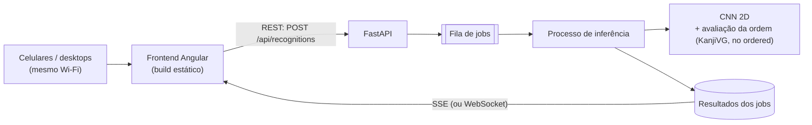
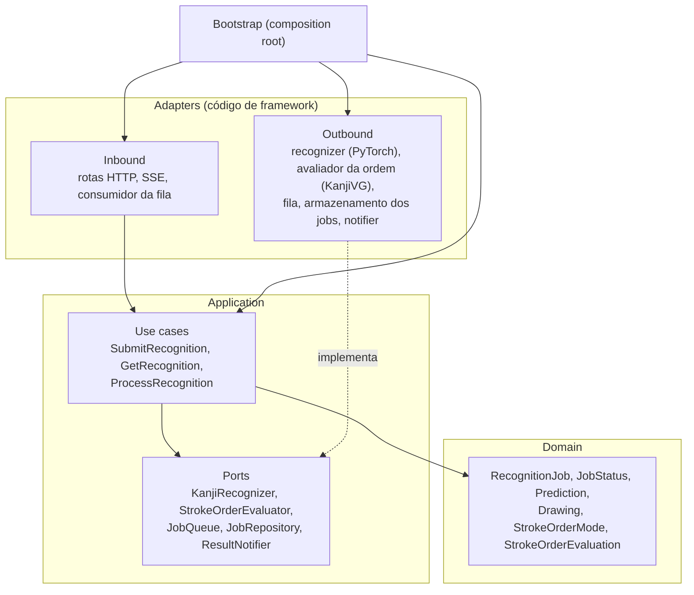
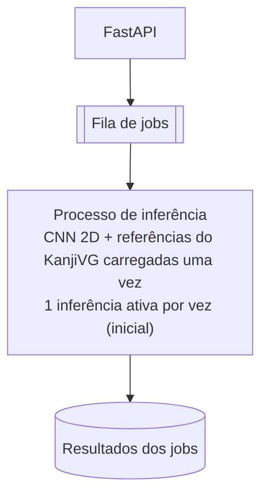

# KanjiLens: Arquitetura

Documento de design do KanjiLens. Registra a arquitetura atual, as decisões já tomadas e as que ainda estão em aberto. O resumo do projeto está no [README](../README.pt-BR.md); o porquê de cada decisão está nas [ADRs](adr/README.md).

> Este documento é vivo. Seções marcadas como **em aberto** ainda não têm decisão. Quando uma for fechada, vira ADR e este documento passa a apontar para ela.

---

## 1. Visão geral

O KanjiLens reconhece kanjis manuscritos. O usuário escolhe se a ordem dos traços deve importar e desenha um kanji num canvas. A aplicação envia os traços e o modo escolhido para um servidor que executa um modelo de Deep Learning, e o servidor devolve uma lista de possíveis kanjis.

O sistema não precisa acertar o caractere com 100% de precisão. Ele apresenta as principais possibilidades, ordenadas por confiança, para que o usuário identifique qual caractere pretendia escrever.

### Objetivos

- Reconhecer kanjis manuscritos com um modelo compacto (CNN 2D) que não depende da ordem dos traços, em dois modos ([ADR 0012](adr/0012-ordered-mode-as-stroke-order-evaluation.md)):
  - **ordem dos traços não importa** (`unordered`): só o reconhecimento;
  - **ordem dos traços importa** (`ordered`): o reconhecimento mais a avaliação da ordem e da direção dos traços contra a referência do KanjiVG, dizendo quais traços estão fora de ordem.
- Disponibilizar uma interface de desenho manual, acessível pelo celular.
- Atender 3–5 alunos enviando desenhos numa janela curta. 10 clientes simultâneos são o cenário de estresse ([ADR 0011](adr/0011-school-notebook-as-server-with-cpu-first-inference.md)).
- Processar as solicitações de forma assíncrona.
- Rodar toda a infraestrutura localmente, sem domínio nem hospedagem externa. O servidor é o notebook da escola, com inferência na CPU; o treino é feito numa máquina mais potente.

---

## 2. Componentes

A aplicação tem três partes, com responsabilidades separadas, todas neste repositório ([ADR 0002](adr/0002-monorepo-for-frontend-backend-and-ml.md)):

| Parte | Pasta | Responsabilidade |
|---|---|---|
| Frontend | `frontend/` | Interação com o usuário: canvas, envio e exibição dos resultados |
| Backend | `backend/` | Recebimento das requisições, gerenciamento dos jobs e notificação |
| Machine Learning | `ml/` | Dataset, pré-processamento, treino e avaliação; o modelo que o backend carrega |



### 2.1 Frontend

**Stack:** Angular, TypeScript, HTML, CSS, HTML Canvas API ([ADR 0003](adr/0003-angular-frontend-and-fastapi-backend.md)). As referências e os padrões de UI/UX estão em [UI-UX.md](UI-UX.md). A interface é em português, com o japonês depois, e todo texto passa pelo i18n desde a primeira tela ([ADR 0009](adr/0009-portuguese-ui-first-then-japanese.md)).

Funcionalidades:

- Escolha do modo antes de reconhecer: a ordem dos traços importa ou não. O modo vai em cada solicitação, e o padrão da interface ainda está em aberto (seção 10).
- Área de desenho com suporte a mouse e touch, que guarda o desenho como **lista de traços**, cada um com a sua sequência de pontos (X, Y). A separação e a ordem dos traços são preservadas ([ADR 0012](adr/0012-ordered-mode-as-stroke-order-evaluation.md)).
- No modo `ordered`, a avaliação da ordem junto dos candidatos: se está correta e quais traços estão fora de ordem ou na direção errada.
- Botão para limpar o canvas.
- Botão para enviar o desenho.
- Indicador de processamento.
- Lista dos kanjis previstos, com a confiança de cada um.
- Verbete do kanji escolhido (leituras, significados). Ainda em aberto (seção 10).

```text
┌──────────────────────────────┐
│          KanjiLens           │
│       Desenhe um kanji       │
│                              │
│ Ordem dos traços:            │
│   [ importa | não importa ]  │
│   ┌──────────────────────┐   │
│   │                      │   │
│   │          日          │   │
│   │                      │   │
│   └──────────────────────┘   │
│                              │
│   [Limpar]     [Reconhecer]  │
│                              │
│   Candidatos                 │
│   日  81%                    │
│   目  12%                    │
│   白   4%                    │
└──────────────────────────────┘
```

### 2.2 Backend

**Stack:** Python, FastAPI, REST, SSE ou WebSocket ([ADR 0003](adr/0003-angular-frontend-and-fastapi-backend.md)).

O processamento é assíncrono: o servidor não mantém a requisição HTTP original aberta enquanto o modelo executa a inferência ([ADR 0005](adr/0005-asynchronous-recognition-with-queue-and-workers.md)).

Fluxo:

1. O frontend envia os traços e o modo (`stroke_order_mode`).
2. O FastAPI recebe a solicitação.
3. O backend gera um `job_id`.
4. O job entra na fila de processamento.
5. O backend responde imediatamente com a confirmação de recebimento.
6. Um worker consome o job e executa a inferência; num job `ordered`, também avalia a ordem dos traços.
7. O resultado é armazenado.
8. O backend notifica o frontend que o job terminou.

Requisição (`POST /api/recognitions`):

```json
{
  "stroke_order_mode": "unordered",
  "strokes": [
    [[0.21, 0.30], [0.48, 0.31], [0.79, 0.30]],
    [[0.50, 0.12], [0.50, 0.55], [0.49, 0.90]]
  ]
}
```

> Cada traço é uma lista de pontos na ordem em que foram desenhados. O formato exato de cada ponto ainda não está fechado, e sai junto com o algoritmo de avaliação da ordem (seção 2.3):
> - normalização das coordenadas;
> - timestamp ou `delta_t`;
> - limite de traços e de pontos (que é o limite de entrada da API).
>
> `stroke_order_mode` aceita `ordered` ou `unordered`; outro valor é rejeitado no adapter HTTP.

Resposta inicial:

```json
{
  "job_id": "abc123",
  "status": "queued"
}
```

Resposta após o processamento:

```json
{
  "job_id": "abc123",
  "status": "completed",
  "stroke_order_mode": "unordered",
  "predictions": [
    { "kanji": "日", "confidence": 0.81 },
    { "kanji": "目", "confidence": 0.12 },
    { "kanji": "白", "confidence": 0.04 }
  ]
}
```

> As confianças são probabilidades da saída Softmax. Por isso a soma das previsões top-K nunca passa de 1.

No modo `ordered`, a resposta também traz a avaliação da ordem. O formato abaixo é ilustrativo e ainda não está fechado ([ADR 0012](adr/0012-ordered-mode-as-stroke-order-evaluation.md)):

```json
{
  "job_id": "abc123",
  "status": "completed",
  "stroke_order_mode": "ordered",
  "predictions": [
    { "kanji": "日", "confidence": 0.81 },
    { "kanji": "目", "confidence": 0.12 }
  ],
  "stroke_order": {
    "kanji": "日",
    "correct": false,
    "expected_strokes": 4,
    "drawn_strokes": 4,
    "issues": [
      { "stroke": 3, "problem": "order", "expected_position": 4 },
      { "stroke": 2, "problem": "direction" }
    ]
  }
}
```

### 2.3 Machine Learning

**Stack:** Python e PyTorch para treino e avaliação, NumPy, OpenCV (opcional, para pré-processamento) ([ADR 0006](adr/0006-cnn-with-pytorch.md)). O runtime de inferência ainda está em aberto: PyTorch CPU, OpenVINO CPU ou ONNX Runtime CPU (seção 4.2).

Os dois modos usam **um único modelo**, a CNN 2D compacta, que não depende da ordem dos traços. O modo `ordered` acrescenta uma **avaliação da ordem contra uma referência**, sem rede neural ([ADR 0012](adr/0012-ordered-mode-as-stroke-order-evaluation.md); a pesquisa está no [spike de modelos, seção 5.3](spikes/model-and-runtime-evaluation.md#53-como-o-modo-ordered-costuma-ser-feito-pesquisa-de-2026-11-08)).

| Parte | O que é | Entrada | Alternativas / em aberto |
|---|---|---|---|
| Reconhecimento (os dois modos) | CNN 2D customizada compacta | Imagem rasterizada final, em tons de cinza; resoluções a comparar: 64×64, 96×96 e 128×128 | Comparadores: MobileNetV3-Small, ResNet-18, HOG + SVM |
| Avaliação da ordem (só `ordered`) | Correspondência entre os traços desenhados e a ordem e a direção do KanjiVG para os candidatos | Traços normalizados e reamostrados, e a referência do KanjiVG | O algoritmo (*DP matching*, bipartite matching / cube search, avaliação incremental com contexto); quantos candidatos avaliar; se só anota ou também reordena |

Ponto de partida da CNN (não fechado; tamanho e profundidade saem dos benchmarks):

```text
Imagem 1×H×W → 3–4 × [Conv2D → Norm → ReLU/SiLU → downsampling]
             → Global Average Pooling → Linear → Softmax → Top-K
```

Pipeline de reconhecimento:

```text
Traços do canvas → Validação → Pré-processamento compartilhado → rasterização → CNN 2D → Softmax → Top-K
                                          │
                                          └─ (ordered) normalização dos traços ─▶ avaliação da ordem
                                                         contra o KanjiVG dos candidatos ─▶ resultado traço a traço
```

**Dados de referência:** o KanjiVG (vetores, ordem e direção de cada traço). Ele é distribuído junto com a aplicação, porque não há saída de rede. A licença (CC BY-SA 3.0, *a confirmar*) exige atribuição e vale também para os dados derivados, à parte da licença MIT do código.

O modelo retorna as K classes mais prováveis, e não apenas a de maior probabilidade. Os dois modos compartilham:
- o contrato da API;
- a validação;
- o modelo;
- o módulo de pré-processamento;
- a fila e os workers;
- o formato da resposta.

O `ordered` só acrescenta a avaliação.

**Projetos de referência:** o [spike, seção 11.1](spikes/model-and-runtime-evaluation.md#111-projetos-de-referência-no-github) lista repositórios públicos para estudo, cada um com as suas limitações e a sua licença:
- `mcyph/cnn_chinese_hw`: traços online;
- `dariyooo/DaKanji-Single-Kanji-Recognition`: CNN compacta por imagem;
- `ATShah03/KanjiRecognizer`: ETL9 + CNN;
- `asdfjkl/kanjicanvas`: baseline geométrico.

Esses projetos **não são dependências aprovadas**. Copiar código, pesos ou dados deles passa pela licença de cada um (há LGPL entre eles; o KanjiLens é MIT) e por uma ADR.

---

## 3. Camadas: Clean Architecture e ports and adapters

Backend e frontend seguem Clean Architecture com ports and adapters (hexagonal), em camadas ([ADR 0004](adr/0004-clean-and-hexagonal-architecture.md)). **As dependências apontam para dentro**: uma camada interna nunca importa uma externa.



### 3.1 Backend (`backend/src/kanjilens/`)

| Camada | O que contém | Pode importar |
|---|---|---|
| `domain/` | Entidades e value objects (`RecognitionJob`, `JobStatus`, `Prediction`, `Drawing` feito de traços, `StrokeOrderMode`, `StrokeOrderEvaluation`) e as regras deles, em Python puro | só a biblioteca padrão |
| `application/use_cases/` | Um use case por ação (`SubmitRecognition`, `GetRecognition`, `ProcessRecognition`) | `domain`, `application/ports` |
| `application/ports/` | As interfaces de que os use cases precisam (`KanjiRecognizer`, `StrokeOrderEvaluator`, `JobQueue`, `JobRepository`, `ResultNotifier`) | `domain` |
| `adapters/inbound/` | Rotas do FastAPI e schemas Pydantic de request/response, o endpoint SSE, o consumidor da fila que chama `ProcessRecognition` | `application`, `domain`, FastAPI |
| `adapters/outbound/` | Implementações dos ports: recognizer em PyTorch, avaliador da ordem com o KanjiVG, `asyncio.Queue` (depois Redis), armazenamento dos jobs em memória, notifier SSE | `application/ports`, `domain`, `kanjilens_ml`, PyTorch, Redis… |
| `bootstrap/` | Composition root: monta os adapters, injeta nos use cases e cria o app FastAPI | tudo |

As duas decisões em aberto do backend (fila e notificação) são **adapters outbound atrás de um port**: trocar `asyncio.Queue` por Redis, ou SSE por WebSocket, substitui um adapter e a ligação em `bootstrap/`, sem mexer nos use cases.

### 3.2 Frontend (`frontend/src/app/`)

| Camada | O que contém | Pode importar |
|---|---|---|
| `domain/` | Modelos (`Drawing` feito de traços, `StrokeOrderMode`, `Prediction`, `StrokeOrderEvaluation`, `RecognitionJob`) e funções puras | nada do Angular |
| `application/` | Use cases / facades (`RecognizeDrawing`) e ports como classes abstratas usadas como token de DI (`RecognitionGateway`, `ResultStream`) | `domain` |
| `infrastructure/` | Implementações dos ports: `HttpRecognitionGateway` (`HttpClient`), `SseResultStream` (`EventSource`) | `application`, `domain`, Angular |
| `presentation/` | Componentes, páginas e rotas: o canvas e a tela de resultados | `application`, `domain`, Angular |

Os adapters são ligados aos ports nos providers de `app.config.ts`. Componente nunca injeta `HttpClient`.

### 3.3 ML (`ml/src/kanjilens_ml/`)

O código de ML é uma biblioteca usada em dois lugares: os scripts de treino em `ml/` e os adapters outbound do backend (o recognizer e o avaliador da ordem). **O pré-processamento existe uma vez só**, em `kanjilens_ml/preprocessing/`, e os dois lados o importam. Ele gera, a partir da mesma lista de traços, a imagem que a CNN recebe e os traços normalizados que a avaliação da ordem usa. `kanjilens_ml/models/` tem a CNN 2D. A avaliação da ordem é um módulo puro, sem PyTorch (proposta: `kanjilens_ml/stroke_order/`), que compara os traços com o KanjiVG. Duas implementações paralelas divergiriam, e o modelo erraria calado em produção (*train/serve skew*).

---

## 4. Processamento assíncrono e concorrência

Para suportar vários alunos ao mesmo tempo, a inferência é separada do recebimento das requisições HTTP ([ADR 0005](adr/0005-asynchronous-recognition-with-queue-and-workers.md)).



### 4.1 Fila de jobs (em aberto)

| | `asyncio.Queue` | Redis + Celery ou RQ |
|---|---|---|
| Complexidade | Baixa, sem infraestrutura extra | Exige Redis rodando |
| Persistência | Em memória; jobs se perdem se o processo cair | Persistente, conforme a configuração |
| Escala | Um único processo | Workers independentes, escaláveis |
| Uso indicado | Validar o fluxo assíncrono na primeira versão | Quando a carga ou a robustez exigirem |

**Direção atual:** começar com `asyncio.Queue` e migrar para Redis + Celery/RQ quando houver necessidade. Os dois são adapters do port `JobQueue` (seção 3.1).

### 4.2 Estratégia de inferência

O servidor é o notebook da escola (seção 6.3), com inferência **CPU-first** ([ADR 0011](adr/0011-school-notebook-as-server-with-cpu-first-inference.md)). A configuração inicial, a validar por benchmark:

1. **Um processo de inferência separado do event loop do FastAPI.** Ele carrega **o modelo e as referências do KanjiVG uma vez**. Nos jobs `ordered`, ele também roda a avaliação da ordem.
2. **Uma fila só** para `ordered` e `unordered`, com **uma inferência ativa por vez** e as threads do runtime controladas.
3. **Uma segunda execução simultânea** (no mesmo processo ou em dois processos de worker) só depois de medir a espera na fila e a latência p95. Dois processos carregam duas cópias do modelo na RAM.
4. **Runtime:** o PyTorch CPU é a referência. Entram na comparação o OpenVINO CPU (prioritário no i7 de 11ª geração) e o ONNX Runtime CPU. INT8 só depois do FP32, e só se não piorar Top-1/Top-5.

**Usuários conectados não são inferências simultâneas.** A meta é aceitar 3–5 envios próximos sem perder jobs, mantendo a API e o SSE responsivos. A fila pode serializar parte do trabalho. O limite numérico de latência só é fixado depois da primeira rodada de medições no notebook.

### 4.3 Pontos de atenção

- **A inferência bloqueia o event loop.** A inferência é CPU-bound. Se o worker rodar como corrotina no mesmo event loop do FastAPI, enquanto ele executa a API para de responder, inclusive as conexões SSE. Com `asyncio.Queue`, a inferência precisa rodar fora do loop (`run_in_executor` com thread ou process pool).
- **O estado em memória não é compartilhado entre processos.** Com `asyncio.Queue`, a fila e os resultados vivem na memória de um processo. Se o Uvicorn subir com `--workers > 1`, cada processo terá sua própria fila, e o cliente pode consultar ou escutar um processo que não conhece o seu `job_id`. Com `asyncio.Queue`, rode um único processo do Uvicorn. Esse é o principal motivo para migrar para Redis.
- **Threads do runtime.** Por padrão, o PyTorch usa todos os núcleos em cada inferência, e o notebook tem 4 núcleos físicos. Configure as threads explicitamente (`torch.set_num_threads` ou o equivalente do runtime escolhido). Dois workers com quatro threads cada disputam os mesmos núcleos, e mais workers não garantem mais throughput.
- **O notebook divide a CPU com tudo:** frontend, API, fila e o modelo. Meça o consumo do conjunto, e não só o do modelo. Em carga longa, o notebook pode sofrer throttling térmico.

---

## 5. Comunicação entre frontend e backend

A comunicação principal é REST. SOAP foi descartado por adicionar complexidade sem benefício para esse cenário.

### 5.1 Endpoints

| Método | Endpoint | Responsabilidade |
|---|---|---|
| `POST` | `/api/recognitions` | Enviar os traços e o modo (`ordered` / `unordered`) para reconhecimento |
| `GET` | `/api/recognitions/{id}` | Consultar o status de um job |
| `GET` | `/api/health` | Verificar disponibilidade do backend |

### 5.2 Notificação: SSE × WebSocket (em aberto)

| | SSE | WebSocket |
|---|---|---|
| Direção | Servidor → cliente | Bidirecional |
| Cliente no browser | `EventSource` nativo, reconexão automática | Reconexão manual |
| Quando faz sentido | Avisar que o job terminou | Progresso detalhado, cancelamento de job, interação contínua |

**Direção atual:** SSE, porque o fluxo principal é o servidor avisando o cliente. WebSocket passa a valer se surgir a necessidade de comunicação bidirecional. Os dois são adapters do port `ResultNotifier` (backend) e do port `ResultStream` (frontend).

O `GET /api/recognitions/{id}` serve de fallback: se a conexão SSE cair, o frontend consulta o status por polling.

---

## 6. Infraestrutura e execução local

O projeto roda inteiramente em uma máquina local. Não são necessários domínio público, hospedagem em nuvem, servidor externo nem exposição à internet ([ADR 0007](adr/0007-local-execution-over-the-lan.md)).

O notebook da escola hospeda a aplicação e funciona como servidor (seção 6.3). Dispositivos na mesma rede Wi-Fi acessam pelo IP local:

```text
Servidor: 192.168.0.10
Angular:  http://192.168.0.10:4200   (desenvolvimento; em produção, build estático)
FastAPI:  http://192.168.0.10:8000
```

O celular é apenas cliente. Toda a inferência roda no servidor.

### 6.1 Configuração necessária

- **Bind dos serviços em `0.0.0.0`.** Por padrão, tanto o `ng serve` quanto o Uvicorn escutam só em `localhost` e ficam invisíveis para o celular. Use `ng serve --host 0.0.0.0` (só no desenvolvimento) e `uvicorn ... --host 0.0.0.0`.
- **Frontend em produção é build estático.** O servidor de desenvolvimento do Angular não é configuração de deploy ([ADR 0011](adr/0011-school-notebook-as-server-with-cpu-first-inference.md)). Como servir o build (pelo próprio FastAPI ou por um servidor estático) fica para o `docs/RUNNING.md`.
- **CORS.** No desenvolvimento, o frontend (porta 4200) e a API (porta 8000) são origens diferentes, e o FastAPI precisa liberar a origem do frontend, e só ela. Em produção, servir o build estático **na mesma origem da API** elimina o CORS. O build pode ser servido pelo próprio FastAPI ou por um proxy na frente dos dois; a escolha fica para o `docs/RUNNING.md`.
- **URL da API no frontend.** Se o frontend chamar `http://localhost:8000`, no celular `localhost` é o próprio celular. Use uma URL relativa (`/api`): no desenvolvimento, o proxy do `ng serve` encaminha para a API; em produção, a mesma origem resolve.
- **Firewall.** Liberar na rede local só as portas em uso: 4200 e 8000 no desenvolvimento, e a porta única de produção.
- **Acesso pelo celular.** O aluno chega pela URL do servidor; a proposta é um QR Code na parede da escola com essa URL, o que depende do IP reservado (abaixo).
- **IP fixo.** O IP do servidor pode mudar a cada conexão ao roteador. Reserve o IP no DHCP do roteador para não precisar reconfigurar.

### 6.2 Exposição na rede local

Qualquer um na mesma rede alcança a API, sem login. As regras que decorrem disso (limite de entrada, fila limitada, CORS restrito, nenhuma saída de rede) estão no `CLAUDE.md`, "Segurança", e passam para o `docs/SECURITY.md` quando a API for exposta pela primeira vez.

### 6.3 Hardware de referência: o notebook da escola

| Item | Especificação |
|---|---|
| Notebook | Dell Inspiron 3501 |
| CPU | Intel Core i7-1165G7: 4 núcleos / 8 threads, até 4,70 GHz, AVX2, AVX-512, DL Boost |
| RAM | 16 GB |
| GPU | Intel Iris Xe integrada; não pressupor GPU dedicada nem uso da integrada pelo runtime (configuração efetiva *a confirmar*) |
| Hospeda | Frontend (build estático), FastAPI, fila, runtime de inferência, o modelo, as referências do KanjiVG e serviços auxiliares que rodarem ali |

O treino roda noutra máquina, mais potente. O que precisa caber no notebook é o artefato final, o runtime, a memória de trabalho e a carga ([ADR 0011](adr/0011-school-notebook-as-server-with-cpu-first-inference.md)).

**Os benchmarks só valem se rodarem no próprio notebook.** As condições:
- ligado na tomada;
- com warm-up;
- com uma rodada longa para ver throttling.

**O que registrar:**
- hardware;
- SO;
- perfil de energia;
- versões de Python e do runtime.

**Cenários de carga:** 1, 2, 3 e 5 clientes, e 10 como estresse, com `ordered` e `unordered` misturados. Medir:
- latência p50/p95;
- espera na fila;
- throughput;
- CPU e RAM;
- temperatura.

---

## 7. Dataset e treinamento

### 7.1 Dataset (em aberto)

O projeto usa um dataset público de kanjis manuscritos. Critérios de escolha:

- Quantidade de kanjis disponíveis.
- Quantidade de amostras por caractere.
- Qualidade das imagens.
- Diversidade de estilos de escrita.
- Licença e possibilidade de uso.
- Compatibilidade com o pipeline de treinamento.

Candidatos a avaliar (licenças e números ainda a confirmar nas fontes oficiais):

- **ETL Character Database (AIST)**, em especial o ETL8G e o ETL9G (tons de cinza) e as variantes binárias (ETL8B2, ETL9B): kanjis modernos escritos à mão por centenas de pessoas. É a referência mais usada para esse problema.
- **Kuzushiji-Kanji**: tem muitas classes, mas é escrita cursiva clássica, bem diferente da escrita moderna. Tende a não servir como base principal.

**Dados por parte** ([ADR 0012](adr/0012-ordered-mode-as-stroke-order-evaluation.md)):

| Parte | Dados necessários | Candidatos |
|---|---|---|
| Reconhecimento (os dois modos) | Imagens do caractere (dados *offline*) para treinar | ETL8G / ETL9G (grayscale 128×127) e as variantes binárias ETL8B2 / ETL9B (64×63) |
| Avaliação da ordem (`ordered`) | A ordem e a direção de referência de cada kanji; **nada de treino** | KanjiVG (licença CC BY-SA 3.0, *a confirmar*), cobrindo toda a lista de classes |
| Teste da avaliação da ordem | Um conjunto fixo de desenhos com ordem certa e errada, com o resultado esperado | Desenhos feitos de propósito para o teste. Coletar desenhos de alunos muda a regra de não guardar desenhos (`CLAUDE.md`, "Segurança") e pede ADR |

O ETL foi digitalizado de folhas de papel: tem a imagem final, sem a trajetória da caneta. Isso basta, porque o modelo não usa a ordem. Datasets *online* (TUAT Kuchibue/Nakayosi, CASIA-OLHWDB) **não são necessários**: o `ordered` não treina um modelo temporal.

A pesquisa que levou a esse desenho está no [spike, seção 5.3](spikes/model-and-runtime-evaluation.md#53-como-o-modo-ordered-costuma-ser-feito-pesquisa-de-2026-11-08): reconhecimento *online* × avaliação da ordem, algoritmos de correspondência entre traços e captura no navegador.

### 7.2 Quantidade de classes (em aberto)

Começar com algumas centenas de kanjis e depois expandir para o conjunto Jōyō (2.136 kanjis).

### 7.3 Avaliação do modelo

Métricas acompanhadas:

- Accuracy Top-1 e Top-5 do reconhecimento (o mesmo modelo nos dois modos).
- Precision, Recall, F1-score e Macro-F1.
- Matriz de confusão.
- Acurácia por faixa de complexidade (quantidade de traços) e por quem escreveu, quando o dataset permitir.
- Invariância do reconhecimento à reordenação dos traços: a mesma figura, desenhada em outra ordem, dá o mesmo resultado.
- **Avaliação da ordem (`ordered`)**, num conjunto fixo de desenhos com ordem certa e errada:
  - erros de ordem e de direção detectados;
  - falsos alarmes em desenhos corretos;
  - comportamento com traços unidos ou quebrados.
- Desempenho no notebook da escola:
  - latência de pré-processamento, de inferência e total (p50/p95);
  - throughput;
  - RAM de pico;
  - tamanho do artefato;
  - cold start.

A Top-5 é a métrica mais próxima da experiência do usuário, já que a interface mostra vários candidatos. A matriz de confusão serve principalmente para analisar kanjis visualmente semelhantes (como 日, 目 e 白).

### 7.4 Pontos de atenção

- **O desenho do canvas é diferente das imagens do dataset.** Datasets como o ETL são digitalizações de papel: tons de cinza, traço de caneta, ruído e contraste próprios. O canvas gera traço sintético, geralmente fino e uniforme, com cores e proporção diferentes. Se o pré-processamento da inferência não aproximar o desenho das imagens de treino (inversão de cores, recorte pela bounding box, centralização, padding, espessura do traço e resolução), a acurácia em produção cai bastante em relação à do conjunto de teste. Esse é o principal risco do projeto e deve ser testado com desenhos reais assim que houver um modelo base.
- **Treino e inferência rodam em máquinas diferentes.** O treino usa uma máquina potente; a inferência, a CPU de um notebook. Um modelo que só é bom porque é grande não cabe no servidor. Toda escolha de modelo é validada no hardware-alvo (seção 6.3).
- **A avaliação da ordem depende do reconhecimento.** Se o kanji certo não estiver entre os candidatos avaliados, a ordem é comparada com o kanji errado. Por isso o Top-K do reconhecimento continua sendo a métrica principal.
- **Traços unidos ou quebrados** mudam a quantidade de traços desenhados, e a avaliação não pode acusar erro falso. Variantes de ordem aceitas na escola precisam ser verificadas com os professores.
- **O pré-processamento precisa ser o mesmo no treino e na inferência.** Ele fica em um único módulo compartilhado entre `ml/` e `backend/` (seção 3.3), nunca em duas implementações paralelas.

---

## 8. Estrutura do repositório

Proposta inicial, ajustável conforme o projeto evoluir:

```text
kanji-lens/
├── frontend/
│   ├── src/app/
│   │   ├── domain/
│   │   ├── application/
│   │   ├── infrastructure/
│   │   └── presentation/
│   ├── angular.json
│   └── package.json
├── backend/
│   ├── src/kanjilens/
│   │   ├── domain/
│   │   ├── application/
│   │   │   ├── ports/
│   │   │   └── use_cases/
│   │   ├── adapters/
│   │   │   ├── inbound/
│   │   │   └── outbound/
│   │   └── bootstrap/
│   ├── tests/
│   └── pyproject.toml
├── ml/
│   ├── src/kanjilens_ml/
│   │   ├── preprocessing/   # compartilhado com o backend
│   │   ├── data/
│   │   ├── models/          # arquitetura nn.Module da CNN 2D (código, não pesos)
│   │   ├── stroke_order/    # avaliação da ordem contra o KanjiVG (sem PyTorch)
│   │   ├── training/
│   │   └── evaluation/
│   ├── configs/             # configurações de treino, versionadas
│   ├── notebooks/           # só exploração; nada importa daqui
│   ├── datasets/            # fora do git
│   └── artifacts/           # pesos treinados, fora do git
├── infrastructure/
│   └── docker/
├── docs/
├── docker-compose.yml
└── README.md
```

> `ml/datasets/` e `ml/artifacts/` são grandes e estão no `.gitignore`. Como obter cada um fica documentado junto do código que os usa (e no `docs/MODEL.md`, a partir da etapa 1).

---

## 9. Escopo do MVP

A primeira versão prioriza o fluxo completo de reconhecimento, de ponta a ponta. Cada etapa vira um épico no GitHub Project ([CONTRIBUTING.md, "Épicos"](../CONTRIBUTING.md#épicos)).

### Etapa 1: Machine Learning

- [x] Avaliar famílias de modelos e runtimes ([spike](spikes/model-and-runtime-evaluation.md)) e definir o modo `ordered` como avaliação da ordem ([ADR 0012](adr/0012-ordered-mode-as-stroke-order-evaluation.md)).
- [ ] Pesquisar e selecionar o dataset e a quantidade de classes.
- [ ] Escolher o algoritmo de avaliação da ordem e o formato de captura dos pontos.
- [ ] Criar o pré-processamento compartilhado (imagem e traços normalizados).
- [ ] Implementar e treinar a CNN 2D compacta.
- [ ] Implementar a avaliação da ordem contra o KanjiVG (`ordered`).
- [ ] Avaliar o reconhecimento (Top-1/Top-5) e a avaliação da ordem (conjunto com ordem certa e errada).
- [ ] Implementar inferência top-K.
- [ ] Medir no notebook da escola, depois de o modelo e o código ficarem prontos (runtimes, resolução, INT8, concorrência).

### Etapa 2: Backend

- [ ] Configurar o projeto FastAPI.
- [ ] Criar o endpoint de reconhecimento.
- [ ] Gerar o `job_id`.
- [ ] Implementar o processamento assíncrono.
- [ ] Integrar o modelo e a avaliação da ordem no processo de inferência.
- [ ] Armazenar os resultados.
- [ ] Implementar a notificação via SSE ou WebSocket.

### Etapa 3: Frontend

- [ ] Criar a aplicação Angular.
- [ ] Implementar o canvas responsivo.
- [ ] Implementar desenho com mouse e touch, capturando os traços.
- [ ] Implementar a escolha do modo (ordem importa / não importa).
- [ ] Implementar a limpeza do canvas.
- [ ] Integrar com a REST API.
- [ ] Implementar o indicador de processamento.
- [ ] Exibir as previsões.

### Etapa 4: Infraestrutura

- [ ] Configurar a execução local no notebook da escola, com o frontend em build estático.
- [ ] Configurar o acesso pela rede Wi-Fi.
- [ ] Configurar a comunicação entre frontend e backend.
- [ ] Avaliar o uso de Redis.
- [ ] Testar 3–5 alunos enviando numa janela curta e 10 clientes como estresse.
- [ ] Medir CPU, memória, temperatura e latência p50/p95 no notebook.

---

## 10. Decisões em resumo

| Decisão | Escolha | Status |
|---|---|---|
| Repositório | Monorepo: frontend, backend e ML juntos | Decidido — [ADR 0002](adr/0002-monorepo-for-frontend-backend-and-ml.md) |
| Frontend / backend | Angular + TypeScript / Python + FastAPI, REST | Decidido — [ADR 0003](adr/0003-angular-frontend-and-fastapi-backend.md) |
| Arquitetura do código | Clean Architecture, ports and adapters, em camadas | Decidido — [ADR 0004](adr/0004-clean-and-hexagonal-architecture.md) |
| Processamento | Assíncrono, com fila e workers | Decidido — [ADR 0005](adr/0005-asynchronous-recognition-with-queue-and-workers.md) |
| Machine Learning | PyTorch para treino e avaliação | Decidido — [ADR 0006](adr/0006-cnn-with-pytorch.md) |
| Modos e modelo | `ordered` / `unordered`, escolhido por solicitação; uma CNN 2D compacta nos dois; no `ordered`, avaliação da ordem contra o KanjiVG | Decidido — [ADR 0012](adr/0012-ordered-mode-as-stroke-order-evaluation.md) (substitui a [0010](adr/0010-two-recognition-modes-with-specialized-models.md)) |
| Servidor e carga | Notebook da escola (Dell Inspiron 3501, i7-1165G7, 16 GB), inferência CPU-first; 3–5 envios numa janela curta, 10 clientes como estresse | Decidido — [ADR 0011](adr/0011-school-notebook-as-server-with-cpu-first-inference.md) |
| Execução | Local / rede local, sem nuvem | Decidido — [ADR 0007](adr/0007-local-execution-over-the-lan.md) |
| Branches e releases | `main` + `develop`, CHANGELOG por release | Decidido — [ADR 0008](adr/0008-git-flow-and-changelog-by-release.md) |
| Notificação do resultado | SSE ou WebSocket | Em aberto (tendência: SSE) |
| Fila | `asyncio.Queue` ou Redis + Celery/RQ | Em aberto (começar com `asyncio.Queue`) |
| Dataset do reconhecimento | ETL8G / ETL9G em avaliação (licença a confirmar) | Em aberto |
| Algoritmo de avaliação da ordem | *DP matching*, bipartite matching / cube search ou avaliação incremental com contexto; quantos candidatos avaliar; se só anota ou também reordena | Em aberto |
| Modo padrão da interface | `ordered` ou `unordered` | Em aberto |
| Verbete do kanji escolhido | Dicionário com dados abertos locais (KANJIDIC2 / JMdict, licença a confirmar) e um link externo como ação secundária, ou só o link | Em aberto (proposta: dados locais, porque não há saída de rede) |
| Runtime, resolução, precisão e concorrência de produção | PyTorch / OpenVINO / ONNX Runtime CPU; 64–128 px; FP32 / INT8; 1 ou 2 execuções | Em aberto (benchmark no notebook) |
| Quantidade de classes | Centenas → 2.136 (Jōyō) | Em aberto |
| Ferramentas de cada stack | Gerenciador de pacotes, linter, test runner | Em aberto — uma ADR no começo de cada etapa |
| Idioma da interface | Português primeiro, japonês depois, com i18n desde a primeira tela | Decidido — [ADR 0009](adr/0009-portuguese-ui-first-then-japanese.md) (o mecanismo de i18n sai na ADR de ferramentas da etapa 3) |

Quando uma decisão em aberto for fechada, ela vira ADR em `docs/adr/` e a linha dela aqui passa a apontar para a ADR.

---

## 11. Objetivo final

Entregar uma aplicação funcional na qual diferentes usuários acessem uma interface web pelo celular ou computador, escolham se a ordem dos traços importa, desenhem kanjis e recebam sugestões de caracteres reconhecidos por um modelo de Deep Learning.

Além do reconhecimento em si, o projeto explora:

- Computer Vision.
- Deep Learning (CNN 2D) e correspondência entre traços para avaliar a ordem.
- Processamento assíncrono.
- Arquitetura orientada a eventos.
- REST API.
- Comunicação em tempo real.
- Concorrência e gerenciamento de filas.
- Integração entre frontend e modelos de Machine Learning.

O foco é uma solução modular, com separação clara entre interface, API, processamento e modelo, permitindo que cada componente evolua de forma independente.
