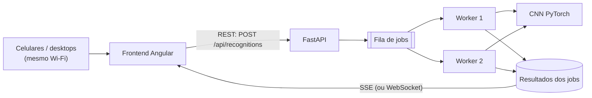
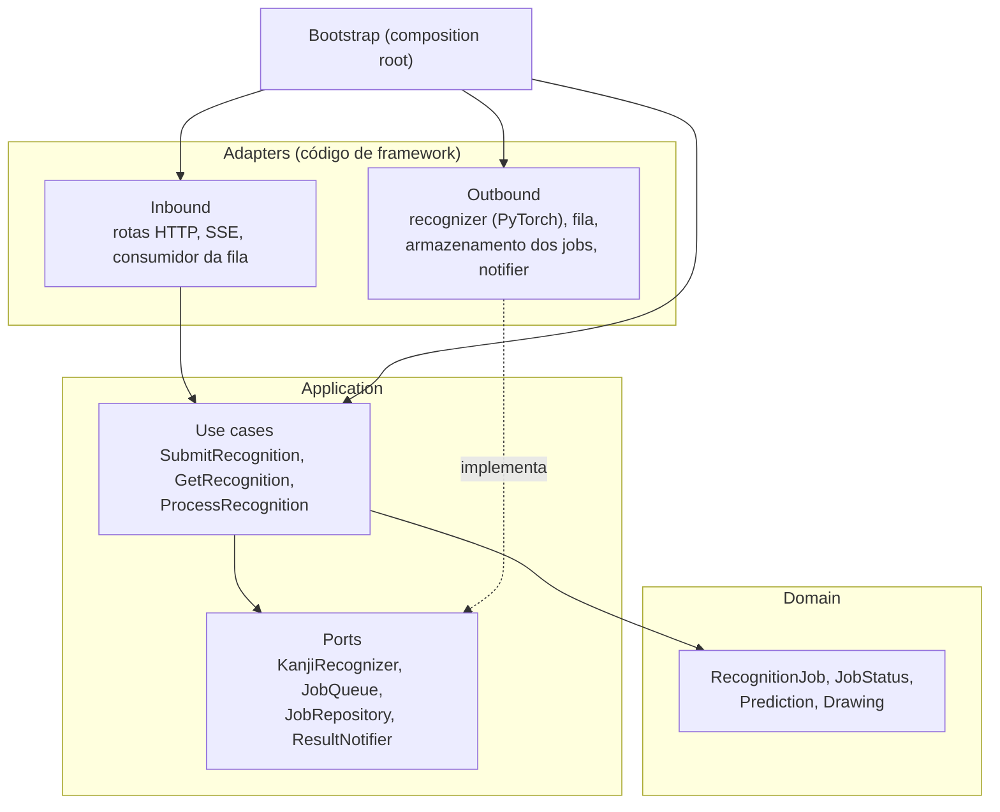
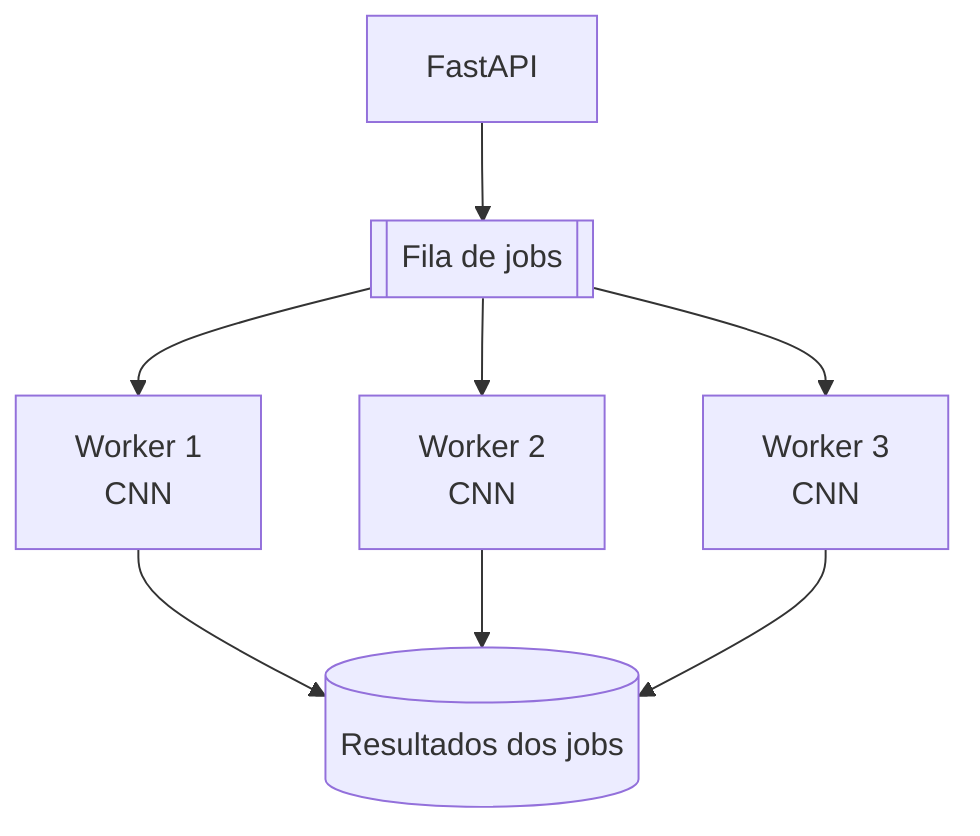

# KanjiLens: Arquitetura

Documento de design do KanjiLens. Registra a arquitetura atual, as decisões já tomadas e as que ainda estão em aberto. O resumo do projeto está no [README](../README.pt-BR.md); o porquê de cada decisão está nas [ADRs](adr/README.md).

> Este documento é vivo. Seções marcadas como **em aberto** ainda não têm decisão. Quando uma for fechada, vira ADR e este documento passa a apontar para ela.

---

## 1. Visão geral

O KanjiLens reconhece kanjis manuscritos. O usuário desenha um kanji em um canvas, a aplicação envia o desenho para um servidor que executa um modelo de Deep Learning, e o servidor devolve uma lista de possíveis kanjis.

O sistema não precisa acertar o caractere com 100% de precisão. Ele apresenta as principais possibilidades, ordenadas por confiança, para que o usuário identifique qual caractere pretendia escrever.

### Objetivos

- Reconhecer kanjis manuscritos com uma CNN.
- Disponibilizar uma interface de desenho manual, acessível pelo celular.
- Suportar múltiplos usuários simultâneos (estimativa inicial: ~10).
- Processar as solicitações de forma assíncrona.
- Rodar toda a infraestrutura localmente, sem domínio nem hospedagem externa.

---

## 2. Componentes

A aplicação tem três partes, com responsabilidades separadas, todas neste repositório ([ADR 0002](adr/0002-monorepo-for-frontend-backend-and-ml.md)):

| Parte | Pasta | Responsabilidade |
|---|---|---|
| Frontend | `frontend/` | Interação com o usuário: canvas, envio e exibição dos resultados |
| Backend | `backend/` | Recebimento das requisições, gerenciamento dos jobs e notificação |
| Machine Learning | `ml/` | Dataset, pré-processamento, treino e avaliação; o modelo que o backend carrega |



### 2.1 Frontend

**Stack:** Angular, TypeScript, HTML, CSS, HTML Canvas API ([ADR 0003](adr/0003-angular-frontend-and-fastapi-backend.md)).

Funcionalidades:

- Área de desenho com suporte a mouse e touch.
- Botão para limpar o canvas.
- Botão para enviar o desenho.
- Indicador de processamento.
- Lista dos kanjis previstos, com a confiança de cada um.

```text
┌──────────────────────────────┐
│          KanjiLens           │
│        Draw your Kanji       │
│                              │
│   ┌──────────────────────┐   │
│   │                      │   │
│   │          日          │   │
│   │                      │   │
│   └──────────────────────┘   │
│                              │
│   [Clear]       [Recognize]  │
│                              │
│   Predictions                │
│   日  81%                    │
│   目  12%                    │
│   白   4%                    │
└──────────────────────────────┘
```

### 2.2 Backend

**Stack:** Python, FastAPI, REST, SSE ou WebSocket ([ADR 0003](adr/0003-angular-frontend-and-fastapi-backend.md)).

O processamento é assíncrono: o servidor não mantém a requisição HTTP original aberta enquanto a CNN executa a inferência ([ADR 0005](adr/0005-asynchronous-recognition-with-queue-and-workers.md)).

Fluxo:

1. O frontend envia o desenho.
2. O FastAPI recebe a solicitação.
3. O backend gera um `job_id`.
4. O job entra na fila de processamento.
5. O backend responde imediatamente com a confirmação de recebimento.
6. Um worker consome o job e executa a inferência.
7. O resultado é armazenado.
8. O backend notifica o frontend que o job terminou.

Resposta inicial:

```json
{
  "job_id": "abc123",
  "status": "queued"
}
```

Resposta após o processamento:

```json
{
  "job_id": "abc123",
  "status": "completed",
  "predictions": [
    { "kanji": "日", "confidence": 0.81 },
    { "kanji": "目", "confidence": 0.12 },
    { "kanji": "白", "confidence": 0.04 }
  ]
}
```

> As confianças são probabilidades da saída Softmax. Por isso a soma das previsões top-K nunca passa de 1.

### 2.3 Machine Learning

**Stack:** Python, PyTorch, NumPy, OpenCV (opcional, para pré-processamento) ([ADR 0006](adr/0006-cnn-with-pytorch.md)).

O modelo é uma CNN treinada para classificar caracteres japoneses manuscritos, a partir de um dataset público (ver [seção 7](#7-dataset-e-treinamento)). O projeto começa com uma arquitetura simples e evolui conforme os resultados.

Arquitetura inicial:

```text
Input Image → Conv2D → ReLU → MaxPooling
            → Conv2D → ReLU → MaxPooling
            → Flatten → Dense → Softmax → Top-K Predictions
```

Pipeline de reconhecimento:

```text
Handwritten Drawing → Image Acquisition → Preprocessing
                    → Normalization → CNN Model → Classification → Top-K Predictions
```

O modelo retorna as K classes mais prováveis, e não apenas a de maior probabilidade.

---

## 3. Camadas: Clean Architecture e ports and adapters

Backend e frontend seguem Clean Architecture com ports and adapters (hexagonal), em camadas ([ADR 0004](adr/0004-clean-and-hexagonal-architecture.md)). **As dependências apontam para dentro**: uma camada interna nunca importa uma externa.



### 3.1 Backend (`backend/src/kanjilens/`)

| Camada | O que contém | Pode importar |
|---|---|---|
| `domain/` | Entidades e value objects (`RecognitionJob`, `JobStatus`, `Prediction`, `Drawing`) e as regras deles, em Python puro | só a biblioteca padrão |
| `application/use_cases/` | Um use case por ação (`SubmitRecognition`, `GetRecognition`, `ProcessRecognition`) | `domain`, `application/ports` |
| `application/ports/` | As interfaces de que os use cases precisam (`KanjiRecognizer`, `JobQueue`, `JobRepository`, `ResultNotifier`) | `domain` |
| `adapters/inbound/` | Rotas do FastAPI e schemas Pydantic de request/response, o endpoint SSE, o consumidor da fila que chama `ProcessRecognition` | `application`, `domain`, FastAPI |
| `adapters/outbound/` | Implementações dos ports: recognizer em PyTorch, `asyncio.Queue` (depois Redis), armazenamento dos jobs em memória, notifier SSE | `application/ports`, `domain`, `kanjilens_ml`, PyTorch, Redis… |
| `bootstrap/` | Composition root: monta os adapters, injeta nos use cases e cria o app FastAPI | tudo |

As duas decisões em aberto do backend (fila e notificação) são **adapters outbound atrás de um port**: trocar `asyncio.Queue` por Redis, ou SSE por WebSocket, substitui um adapter e a ligação em `bootstrap/`, sem mexer nos use cases.

### 3.2 Frontend (`frontend/src/app/`)

| Camada | O que contém | Pode importar |
|---|---|---|
| `domain/` | Modelos (`Prediction`, `RecognitionJob`) e funções puras | nada do Angular |
| `application/` | Use cases / facades (`RecognizeDrawing`) e ports como classes abstratas usadas como token de DI (`RecognitionGateway`, `ResultStream`) | `domain` |
| `infrastructure/` | Implementações dos ports: `HttpRecognitionGateway` (`HttpClient`), `SseResultStream` (`EventSource`) | `application`, `domain`, Angular |
| `presentation/` | Componentes, páginas e rotas: o canvas e a tela de resultados | `application`, `domain`, Angular |

Os adapters são ligados aos ports nos providers de `app.config.ts`. Componente nunca injeta `HttpClient`.

### 3.3 ML (`ml/src/kanjilens_ml/`)

O código de ML é uma biblioteca usada em dois lugares: os scripts de treino em `ml/` e o adapter do recognizer no backend. **O pré-processamento existe uma vez só**, em `kanjilens_ml/preprocessing/`, e os dois lados o importam. Duas implementações paralelas divergiriam, e o modelo erraria calado em produção (*train/serve skew*).

---

## 4. Processamento assíncrono e concorrência

Para suportar múltiplos usuários simultâneos, a inferência é separada do recebimento das requisições HTTP ([ADR 0005](adr/0005-asynchronous-recognition-with-queue-and-workers.md)).



### 4.1 Fila de jobs (em aberto)

| | `asyncio.Queue` | Redis + Celery ou RQ |
|---|---|---|
| Complexidade | Baixa, sem infraestrutura extra | Exige Redis rodando |
| Persistência | Em memória; jobs se perdem se o processo cair | Persistente, conforme a configuração |
| Escala | Um único processo | Workers independentes, escaláveis |
| Uso indicado | Validar o fluxo assíncrono na primeira versão | Quando a carga ou a robustez exigirem |

**Direção atual:** começar com `asyncio.Queue` e migrar para Redis + Celery/RQ quando houver necessidade. Os dois são adapters do port `JobQueue` (seção 3.1).

### 4.2 Estratégia de inferência

- O modelo é carregado **uma vez por worker** e reutilizado em todas as inferências.
- A quantidade de workers depende dos recursos do computador servidor: CPU, memória e GPU.

### 4.3 Pontos de atenção

- **A inferência bloqueia o event loop.** A inferência do PyTorch é CPU/GPU-bound. Se o worker rodar como corrotina no mesmo event loop do FastAPI, enquanto ele executa a API para de responder, inclusive as conexões SSE. Com `asyncio.Queue`, a inferência precisa rodar fora do loop (`run_in_executor` com thread ou process pool).
- **O estado em memória não é compartilhado entre processos.** Com `asyncio.Queue`, a fila e os resultados vivem na memória de um processo. Se o Uvicorn subir com `--workers > 1`, cada processo terá sua própria fila, e o cliente pode consultar ou escutar um processo que não conhece o seu `job_id`. Na opção 1, rode um único processo do Uvicorn. Esse é o principal motivo para migrar para Redis.
- **Threads do PyTorch.** Por padrão, o PyTorch usa todos os núcleos em cada inferência. Com vários workers no mesmo processo, ajuste `torch.set_num_threads` para que os workers não disputem a CPU.

---

## 5. Comunicação entre frontend e backend

A comunicação principal é REST. SOAP foi descartado por adicionar complexidade sem benefício para esse cenário.

### 5.1 Endpoints

| Método | Endpoint | Responsabilidade |
|---|---|---|
| `POST` | `/api/recognitions` | Enviar um desenho para reconhecimento |
| `GET` | `/api/recognitions/{id}` | Consultar o status de um job |
| `GET` | `/api/health` | Verificar disponibilidade do backend |

### 5.2 Notificação: SSE × WebSocket (em aberto)

| | SSE | WebSocket |
|---|---|---|
| Direção | Servidor → cliente | Bidirecional |
| Cliente no browser | `EventSource` nativo, reconexão automática | Reconexão manual |
| Quando faz sentido | Avisar que o job terminou | Progresso detalhado, cancelamento de job, interação contínua |

**Direção atual:** SSE, porque o fluxo principal é o servidor avisando o cliente. WebSocket passa a valer se surgir a necessidade de comunicação bidirecional. Os dois são adapters do port `ResultNotifier` (backend) e do port `ResultStream` (frontend).

O `GET /api/recognitions/{id}` serve de fallback: se a conexão SSE cair, o frontend consulta o status por polling.

---

## 6. Infraestrutura e execução local

O projeto roda inteiramente em uma máquina local. Não são necessários domínio público, hospedagem em nuvem, servidor externo nem exposição à internet ([ADR 0007](adr/0007-local-execution-over-the-lan.md)).

O computador que hospeda a aplicação funciona como servidor. Dispositivos na mesma rede Wi-Fi acessam pelo IP local:

```text
Servidor: 192.168.0.10
Angular:  http://192.168.0.10:4200
FastAPI:  http://192.168.0.10:8000
```

O celular é apenas cliente. Toda a inferência roda no servidor.

### 6.1 Configuração necessária

- **Bind dos serviços em `0.0.0.0`.** Por padrão, tanto o `ng serve` quanto o Uvicorn escutam só em `localhost` e ficam invisíveis para o celular. Use `ng serve --host 0.0.0.0` e `uvicorn ... --host 0.0.0.0`.
- **CORS.** O frontend (porta 4200) e a API (porta 8000) são origens diferentes. O FastAPI precisa liberar a origem do frontend, e só ela.
- **URL da API no frontend.** Se o frontend chamar `http://localhost:8000`, no celular `localhost` é o próprio celular. A URL da API precisa usar o IP do servidor, ou o Angular pode usar um proxy para a API (assim tudo passa pela porta 4200 e o CORS deixa de ser necessário).
- **Firewall.** Liberar as portas 4200 e 8000 na rede local.
- **IP fixo.** O IP do servidor pode mudar a cada conexão ao roteador. Reserve o IP no DHCP do roteador para não precisar reconfigurar.

### 6.2 Exposição na rede local

Qualquer um na mesma rede alcança a API, sem login. As regras que decorrem disso (limite de entrada, fila limitada, CORS restrito, nenhuma saída de rede) estão no `CLAUDE.md`, "Segurança", e passam para o `docs/SECURITY.md` quando a API for exposta pela primeira vez.

---

## 7. Dataset e treinamento

### 7.1 Dataset (em aberto)

O projeto usa um dataset público de kanjis manuscritos. Critérios de escolha:

- Quantidade de kanjis disponíveis.
- Quantidade de amostras por caractere.
- Qualidade das imagens.
- Diversidade de estilos de escrita.
- Licença e possibilidade de uso.
- Compatibilidade com o pipeline de treinamento.

Candidatos a avaliar (licenças e números ainda a confirmar nas fontes oficiais):

- **ETL Character Database (AIST)**, em especial o ETL8G e o ETL9B: kanjis modernos escritos à mão por centenas de pessoas. É a referência mais usada para esse problema.
- **Kuzushiji-Kanji**: tem muitas classes, mas é escrita cursiva clássica, bem diferente da escrita moderna. Tende a não servir como base principal.

### 7.2 Quantidade de classes (em aberto)

Começar com algumas centenas de kanjis e depois expandir para o conjunto Jōyō (2.136 kanjis).

### 7.3 Avaliação do modelo

Métricas acompanhadas:

- Accuracy Top-1 e Top-5.
- Precision, Recall e F1-score.
- Matriz de confusão.
- Tempo médio de inferência.

A Top-5 é a métrica mais próxima da experiência do usuário, já que a interface mostra vários candidatos. A matriz de confusão serve principalmente para analisar kanjis visualmente semelhantes (como 日, 目 e 白).

### 7.4 Pontos de atenção

- **O desenho do canvas é diferente das imagens do dataset.** Datasets como o ETL são digitalizações de papel: tons de cinza, traço de caneta, ruído e contraste próprios. O canvas gera traço sintético, geralmente fino e uniforme, com cores e proporção diferentes. Se o pré-processamento da inferência não aproximar o desenho das imagens de treino (inversão de cores, recorte pela bounding box, centralização, padding, espessura do traço e resolução), a acurácia em produção cai bastante em relação à do conjunto de teste. Esse é o principal risco do projeto e deve ser testado com desenhos reais assim que houver um modelo base.
- **O pré-processamento precisa ser o mesmo no treino e na inferência.** Ele fica em um único módulo compartilhado entre `ml/` e `backend/` (seção 3.3), nunca em duas implementações paralelas.

---

## 8. Estrutura do repositório

Proposta inicial, ajustável conforme o projeto evoluir:

```text
kanji-lens/
├── frontend/
│   ├── src/app/
│   │   ├── domain/
│   │   ├── application/
│   │   ├── infrastructure/
│   │   └── presentation/
│   ├── angular.json
│   └── package.json
├── backend/
│   ├── src/kanjilens/
│   │   ├── domain/
│   │   ├── application/
│   │   │   ├── ports/
│   │   │   └── use_cases/
│   │   ├── adapters/
│   │   │   ├── inbound/
│   │   │   └── outbound/
│   │   └── bootstrap/
│   ├── tests/
│   └── pyproject.toml
├── ml/
│   ├── src/kanjilens_ml/
│   │   ├── preprocessing/   # compartilhado com o backend
│   │   ├── data/
│   │   ├── models/          # arquiteturas nn.Module (código, não pesos)
│   │   ├── training/
│   │   └── evaluation/
│   ├── configs/             # configurações de treino, versionadas
│   ├── notebooks/           # só exploração; nada importa daqui
│   ├── datasets/            # fora do git
│   └── artifacts/           # pesos treinados, fora do git
├── infrastructure/
│   └── docker/
├── docs/
├── docker-compose.yml
└── README.md
```

> `ml/datasets/` e `ml/artifacts/` são grandes e estão no `.gitignore`. Como obter cada um fica documentado junto do código que os usa (e no `docs/MODEL.md`, a partir da etapa 1).

---

## 9. Escopo do MVP

A primeira versão prioriza o fluxo completo de reconhecimento, de ponta a ponta. Cada etapa vira um épico no GitHub Project ([CONTRIBUTING.md, "Épicos"](../CONTRIBUTING.md#épicos)).

### Etapa 1: Machine Learning

- [ ] Pesquisar datasets de kanjis manuscritos.
- [ ] Selecionar o dataset.
- [ ] Pré-processar as imagens.
- [ ] Implementar uma CNN inicial.
- [ ] Treinar o modelo.
- [ ] Avaliar os resultados.
- [ ] Implementar inferência top-K.

### Etapa 2: Backend

- [ ] Configurar o projeto FastAPI.
- [ ] Criar o endpoint de reconhecimento.
- [ ] Gerar o `job_id`.
- [ ] Implementar o processamento assíncrono.
- [ ] Integrar o modelo PyTorch.
- [ ] Armazenar os resultados.
- [ ] Implementar a notificação via SSE ou WebSocket.

### Etapa 3: Frontend

- [ ] Criar a aplicação Angular.
- [ ] Implementar o canvas responsivo.
- [ ] Implementar desenho com mouse e touch.
- [ ] Implementar a limpeza do canvas.
- [ ] Integrar com a REST API.
- [ ] Implementar o indicador de processamento.
- [ ] Exibir as previsões.

### Etapa 4: Infraestrutura

- [ ] Configurar a execução local.
- [ ] Configurar o acesso pela rede Wi-Fi.
- [ ] Configurar a comunicação entre frontend e backend.
- [ ] Avaliar o uso de Redis.
- [ ] Testar múltiplos usuários simultâneos.
- [ ] Medir o consumo de CPU, memória e GPU.

---

## 10. Decisões em resumo

| Decisão | Escolha | Status |
|---|---|---|
| Repositório | Monorepo: frontend, backend e ML juntos | Decidido — [ADR 0002](adr/0002-monorepo-for-frontend-backend-and-ml.md) |
| Frontend / backend | Angular + TypeScript / Python + FastAPI, REST | Decidido — [ADR 0003](adr/0003-angular-frontend-and-fastapi-backend.md) |
| Arquitetura do código | Clean Architecture, ports and adapters, em camadas | Decidido — [ADR 0004](adr/0004-clean-and-hexagonal-architecture.md) |
| Processamento | Assíncrono, com fila e workers | Decidido — [ADR 0005](adr/0005-asynchronous-recognition-with-queue-and-workers.md) |
| Machine Learning | PyTorch, CNN | Decidido — [ADR 0006](adr/0006-cnn-with-pytorch.md) |
| Execução | Local / rede local, sem nuvem | Decidido — [ADR 0007](adr/0007-local-execution-over-the-lan.md) |
| Branches e releases | `main` + `develop`, CHANGELOG por release | Decidido — [ADR 0008](adr/0008-git-flow-and-changelog-by-release.md) |
| Usuários simultâneos estimados | ~10 | Estimativa |
| Notificação do resultado | SSE ou WebSocket | Em aberto (tendência: SSE) |
| Fila | `asyncio.Queue` ou Redis + Celery/RQ | Em aberto (começar com `asyncio.Queue`) |
| Dataset | A definir | Em aberto |
| Quantidade de classes | Centenas → 2.136 (Jōyō) | Em aberto |
| Ferramentas de cada stack | Gerenciador de pacotes, linter, test runner | Em aberto — uma ADR no começo de cada etapa |

Quando uma decisão em aberto for fechada, ela vira ADR em `docs/adr/` e a linha dela aqui passa a apontar para a ADR.

---

## 11. Objetivo final

Entregar uma aplicação funcional na qual diferentes usuários acessem uma interface web pelo celular ou computador, desenhem kanjis e recebam sugestões de caracteres reconhecidos por um modelo de Deep Learning.

Além do reconhecimento em si, o projeto explora:

- Computer Vision.
- Deep Learning e CNN.
- Processamento assíncrono.
- Arquitetura orientada a eventos.
- REST API.
- Comunicação em tempo real.
- Concorrência e gerenciamento de filas.
- Integração entre frontend e modelos de Machine Learning.

O foco é uma solução modular, com separação clara entre interface, API, processamento e modelo, permitindo que cada componente evolua de forma independente.
