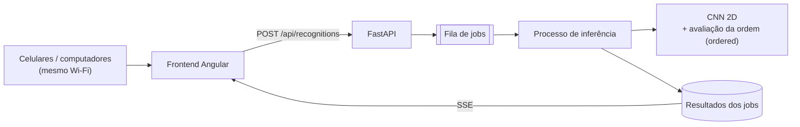
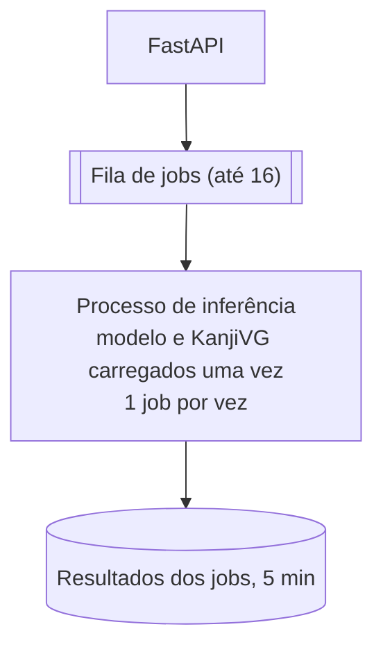

# KanjiLens: Arquitetura

Como o KanjiLens é montado hoje e o que ainda está em aberto. O resumo do projeto está no [README](../README.md). O porquê de cada decisão está nas [ADRs](adr/README.md).

## 1. Visão geral

A pessoa escolhe se a ordem dos traços importa, desenha um kanji no canvas e recebe uma lista de kanjis prováveis, do mais para o menos provável. Não precisa acertar sempre: basta o kanji certo aparecer entre os primeiros.

- **Dois modos** ([ADR 0012](adr/0012-ordered-mode-as-stroke-order-evaluation.md)):
  - `unordered` (padrão): só o reconhecimento;
  - `ordered`: o reconhecimento mais a comparação da ordem e da direção dos traços com o KanjiVG.
- **Um modelo só nos dois modos:** uma CNN 2D compacta, que olha a imagem final e não depende da ordem.
- **Carga:** 3 a 5 alunos mandando desenhos quase juntos; 10 clientes é o teste de estresse ([ADR 0011](adr/0011-school-notebook-as-server-with-cpu-first-inference.md)).
- **Tudo local:** o servidor é o notebook da escola, sem nuvem, com inferência na CPU. O treino roda numa máquina mais forte.

## 2. Componentes

Três partes no mesmo repositório ([ADR 0002](adr/0002-monorepo-for-frontend-backend-and-ml.md)):

| Parte | Pasta | Faz |
|---|---|---|
| Frontend | `frontend/` | Canvas, escolha do modo, envio e resultado |
| Backend | `backend/` | Recebe o desenho, cuida dos jobs e avisa o resultado |
| ML | `ml/` | Pré-processamento, avaliação da ordem, e depois dataset, treino e modelo |



### 2.1 Frontend

Angular e TypeScript ([ADR 0003](adr/0003-angular-frontend-and-fastapi-backend.md), [ADR 0017](adr/0017-frontend-tooling-angular-localize-vitest-eslint-boundaries.md)), numa tela só: a escolha do modo, o canvas (mouse, toque ou caneta, com "Desfazer traço" e "Limpar"), "Reconhecer" com o estado do job e, depois, a lista de candidatos ([#59](https://github.com/Asuka-Jyuku/kanji-lens/issues/59)) com link para um dicionário externo ([#35](https://github.com/Asuka-Jyuku/kanji-lens/issues/35)). Os textos são em português, sempre pelo i18n ([ADR 0009](adr/0009-portuguese-ui-first-then-japanese.md)). Os padrões de tela estão no [UI-UX.md](UI-UX.md).

### 2.2 Backend

Python e FastAPI, com REST e SSE ([ADR 0003](adr/0003-angular-frontend-and-fastapi-backend.md), [ADR 0020](adr/0020-result-notification-by-server-sent-events.md)). A requisição não fica aberta enquanto o modelo roda ([ADR 0005](adr/0005-asynchronous-recognition-with-queue-and-workers.md)):

1. O frontend manda os traços e o modo.
2. A API cria um job, põe na fila e responde na hora com o `job_id`.
3. O processo de inferência pega o job, reconhece e, no `ordered`, avalia a ordem.
4. O resultado fica em memória por 5 minutos.
5. Cada mudança de estado vai para o frontend por SSE.

Hoje o reconhecedor e a avaliação da ordem do backend ainda são falsos (`placeholder.py`): o reconhecedor sempre responde 日, 目 e 白. O modelo e o KanjiVG entram na [#48](https://github.com/Asuka-Jyuku/kanji-lens/issues/48).

**Requisição** (`POST /api/recognitions`):

```json
{
  "stroke_order_mode": "unordered",
  "canvas": { "width": 320, "height": 320 },
  "strokes": [
    [[41.0, 30.5, 0], [41.2, 88.0, 140]],
    [[44.1, 31.0, 410], [118.3, 29.4, 590], [117.9, 92.2, 780]]
  ]
}
```

Formato da [ADR 0016](adr/0016-stroke-order-check-by-bipartite-matching-and-capture-format.md):
- cada traço é uma lista de pontos `[x, y, t]`, na ordem do desenho;
- `x` e `y` em pixels CSS a partir do canto superior esquerdo, como desenhados;
- `t` em milissegundos desde o primeiro ponto, inteiro e nunca decrescente;
- **limites:** até 40 traços, 1.000 pontos por traço e 10.000 no total; pontos até 10% fora do canvas; canvas de 64 a 4.096 px por lado;
- `stroke_order_mode` é `ordered` ou `unordered`.

**Resposta inicial** (`202 Accepted`):

```json
{ "job_id": "abc123", "status": "queued" }
```

**Job pronto:**

```json
{
  "job_id": "abc123",
  "status": "completed",
  "stroke_order_mode": "unordered",
  "predictions": [
    { "kanji": "日", "confidence": 0.81 },
    { "kanji": "目", "confidence": 0.12 },
    { "kanji": "白", "confidence": 0.04 }
  ]
}
```

As confianças saem da Softmax, então a soma nunca passa de 1.

O `GET /api/recognitions/{id}` e cada evento do SSE devolvem **esse mesmo formato**, em qualquer estado. Campo que não se aplica não vem, nem como `null`:
- `queued` e `processing`: só `job_id`, `status` e `stroke_order_mode`;
- `unordered`: os candidatos não têm `stroke_order`;
- `failed`: sem `predictions` e com `failure` (hoje só `inference_failed`).

```json
{ "job_id": "abc123", "status": "failed", "stroke_order_mode": "ordered", "failure": "inference_failed" }
```

**No `ordered`**, cada candidato traz a avaliação da ordem. Ela só anota; não muda a ordem dos candidatos:

```json
{
  "job_id": "abc123",
  "status": "completed",
  "stroke_order_mode": "ordered",
  "predictions": [
    {
      "kanji": "日",
      "confidence": 0.81,
      "stroke_order": {
        "status": "evaluated",
        "correct": false,
        "expected_strokes": 4,
        "drawn_strokes": 4,
        "issues": [
          { "type": "order", "drawn_stroke": 3, "expected_position": 4 },
          { "type": "direction", "drawn_stroke": 2 }
        ]
      }
    },
    {
      "kanji": "目",
      "confidence": 0.12,
      "stroke_order": { "status": "not_evaluated", "reason": "stroke_count_mismatch" }
    }
  ]
}
```

- **Tipos de problema:** `order`, `direction`, `joined` (um traço desenhado que une traços vizinhos da referência: `drawn_stroke` e `expected_strokes`) e `broken` (um traço da referência desenhado em pedaços: `drawn_strokes` e `expected_stroke`).
- **Numeração** a partir de 1, como na tela.
- **`correct`** olha só ordem e direção. Traço unido ou quebrado é só observação.
- **`not_evaluated`:** a quantidade de traços difere em mais de 2 (`stroke_count_mismatch`) ou o kanji não está no KanjiVG (`reference_missing`).

### 2.3 Machine Learning

Python, PyTorch para treino e avaliação, NumPy e SciPy ([ADR 0006](adr/0006-cnn-with-pytorch.md)). O runtime de inferência ainda está em aberto (seção 4.2).

- **Reconhecimento (os dois modos):** uma CNN 2D compacta, que recebe a imagem do desenho em tons de cinza (64, 96 ou 128 px, a comparar). Vai treinar com desenhos sintéticos do KanjiVG enquanto o ETL estiver fora ([ADR 0022](adr/0022-synthetic-training-data-from-kanjivg-while-etl-is-down.md); [#14](https://github.com/Asuka-Jyuku/kanji-lens/issues/14), [#92](https://github.com/Asuka-Jyuku/kanji-lens/issues/92), [#13](https://github.com/Asuka-Jyuku/kanji-lens/issues/13), [#15](https://github.com/Asuka-Jyuku/kanji-lens/issues/15)).
- **Avaliação da ordem (só `ordered`):** pareia os traços desenhados com os do KanjiVG pelo algoritmo húngaro, aceitando até 2 traços unidos ou quebrados, e confere a direção ([ADR 0016](adr/0016-stroke-order-check-by-bipartite-matching-and-capture-format.md)). Está pronta e medida em desenhos sintéticos ([MODEL.md](MODEL.md#avaliação-da-ordem-dos-traços)); o ajuste fino espera desenhos reais ([#29](https://github.com/Asuka-Jyuku/kanji-lens/issues/29)).

Ponto de partida da CNN (o tamanho sai dos benchmarks):

```text
Imagem 1×H×W → 3–4 × [Conv2D → Norm → ReLU/SiLU → downsampling]
             → Global Average Pooling → Linear → Softmax → Top-K
```

**KanjiVG:** a referência de ordem e direção, numa versão fixada com checksum e gerada fora do git ([MODEL.md](MODEL.md#dados-de-referência-kanjivg)). A licença é CC BY-SA 3.0 e pede atribuição, inclusive na tela.

Os projetos públicos usados como estudo estão no [spike, seção 11.1](spikes/model-and-runtime-evaluation.md#111-projetos-de-referência-no-github). Copiar algo deles passa pela licença de cada um e por uma ADR.

## 3. Camadas: Clean Architecture e ports and adapters

Backend e frontend usam camadas com ports and adapters ([ADR 0004](adr/0004-clean-and-hexagonal-architecture.md)). A regra é uma só: **as dependências apontam para dentro**. O domínio não conhece framework; só os adapters tocam em FastAPI, PyTorch, `HttpClient` ou nas APIs do navegador. Um teste de arquitetura em cada parte quebra se um import fura essa regra.

Port novo só entra quando há uma segunda implementação de verdade (os fakes de teste não contam).

### 3.1 Backend (`backend/src/kanjilens/`)

| Camada | O que tem |
|---|---|
| `domain/` | `RecognitionJob` e os estados, `Drawing`, `Prediction`, `StrokeOrderMode` e a avaliação da ordem, em Python puro ([architecture/domain.md](architecture/domain.md)) |
| `application/` | Os use cases (`SubmitRecognition`, `GetRecognition`, `ProcessRecognition`) e os ports de que eles precisam: `KanjiRecognizer`, `StrokeOrderEvaluator`, `JobQueue`, `JobRepository`, `ResultNotifier`. O horário entra como uma função `now` |
| `adapters/inbound/` | As rotas HTTP e os schemas Pydantic, o limite de tamanho do corpo, os erros `{"error": "<código>"}`, o SSE e o consumidor da fila |
| `adapters/outbound/` | O processo de inferência, o recognizer e o avaliador da ordem, a fila (`asyncio.Queue`), os jobs em memória e o notifier do SSE |
| `bootstrap/` | Monta tudo e cria o app FastAPI, com o `/api/health` |

### 3.2 Frontend (`frontend/src/app/`)

| Camada | O que tem |
|---|---|
| `domain/` | O desenho e os limites dele, o modo, o corpo do `POST` (`RecognitionRequest`), o job e o estado da tela, em TypeScript puro |
| `application/` | `DrawingSession` (o desenho e o modo escolhido, com `mode` e `chooseMode()`), o use case `RecognizeDrawing` e os ports `RecognitionGateway` e `ResultStream` |
| `infrastructure/` | `HttpRecognitionGateway` (`HttpClient`) e `SseResultStream` (`EventSource`), com a leitura do JSON da API num lugar só (`recognition-api.ts`) |
| `presentation/` | Os componentes: escolha do modo, canvas, "Reconhecer" com o estado, a lista de candidatos com a avaliação da ordem em texto, e a exportação do desenho (só no desenvolvimento) |

Os ports são ligados aos adapters em `app.config.ts`. Componente nunca injeta `HttpClient`.

**Ferramenta só de desenvolvimento:** a exportação do desenho em JSON ([MODEL.md](MODEL.md#desenhos-do-canvas)) fica inteira em `presentation/drawing-export/`. O `App` mostra o `DEV_TOOL` de `app.dev-tools.ts`, que o `fileReplacements` do `angular.json` troca por `app.dev-tools.development.ts` só no build de desenvolvimento. No de produção ela nem entra no bundle, e o CI confere (`npm run check:production-bundle`).

### 3.3 ML (`ml/src/kanjilens_ml/`)

É uma biblioteca, usada pelos scripts de `ml/` e pelos adapters do backend.
- `preprocessing/`: **o pré-processamento existe uma vez só**, e treino e inferência importam o mesmo módulo. Hoje tem os traços normalizados; a imagem da CNN entra na [#14](https://github.com/Asuka-Jyuku/kanji-lens/issues/14). Duas cópias que divergem fazem o modelo errar calado em produção (*train/serve skew*).
- `stroke_order/`: a avaliação da ordem, sem PyTorch.

As pastas do modelo, do treino e da avaliação nascem com o código delas.

## 4. Processamento assíncrono e concorrência



### 4.1 Fila de jobs

Decidida na [ADR 0019](adr/0019-in-memory-job-queue-with-one-inference-process.md):
- **Fila:** `asyncio.Queue` com até 16 jobs. Cheia, a API responde `503 queue_full` com `Retry-After: 5`.
- **Consumo:** um job por vez, num processo separado (`ProcessPoolExecutor(max_workers=1)`, contexto `spawn`). O modelo e o KanjiVG carregam uma vez, quando o processo nasce. Se ele cair, o job falha e o processo é recriado.
- **Jobs em memória**, apagados 5 minutos depois do fim. Por isso o Uvicorn roda com **um processo só** (sem `--workers`).
- **Sem Redis, RQ ou Celery:** nenhum deles roda bem no Windows do notebook. Fila persistente só com ADR nova.

### 4.2 Estratégia de inferência

Inferência na CPU do notebook ([ADR 0011](adr/0011-school-notebook-as-server-with-cpu-first-inference.md)). Começa simples e só muda depois de medir:
- **Fora do event loop:** inferência no mesmo processo da API trava tudo, inclusive o SSE.
- **Uma inferência por vez,** com as threads do runtime fixadas (`torch.set_num_threads`): o notebook tem 4 núcleos e divide a CPU com a API e o frontend. Uma segunda inferência simultânea só se a espera na fila pedir; ela custa outra cópia do modelo na RAM.
- **Runtime:** PyTorch CPU como referência, comparado com OpenVINO e ONNX Runtime. INT8 só se não piorar o Top-1/Top-5.

## 5. Comunicação entre frontend e backend

REST para o envio e a consulta, SSE para o aviso.

### 5.1 Endpoints

| Método | Endpoint | Faz |
|---|---|---|
| `POST` | `/api/recognitions` | Envia os traços e o modo |
| `GET` | `/api/recognitions/{id}` | Consulta o estado do job (reserva do SSE) |
| `GET` | `/api/recognitions/{id}/events` | Recebe as mudanças de estado por SSE |
| `GET` | `/api/health` | Diz se a API está de pé |

### 5.2 Notificação: SSE

Decidida na [ADR 0020](adr/0020-result-notification-by-server-sent-events.md):
- **Um evento por mudança de estado:** `event:` é o estado; `data:` é o job completo, no formato do `GET`. O stream termina no estado final, e o FastAPI manda keep-alive a cada 15 s.
- **Reconectar é simples:** cada evento traz o estado inteiro.
- **No frontend**, o `SseResultStream` usa o `EventSource` do navegador. Se o SSE falhar 3 vezes seguidas sem estado novo, ou o navegador desistir, o `RecognizeDrawing` passa a consultar o `GET` a cada 1 s. Sem estado final em 60 s, a tela diz que o servidor demorou.

### 5.3 Erros

Todo erro tem o corpo `{"error": "<código>"}`. O frontend traduz o código; o backend nunca manda texto para a tela ([ADR 0009](adr/0009-portuguese-ui-first-then-japanese.md)).

| Status | Código | Quando |
|---|---|---|
| `400` | `invalid_drawing` | O desenho quebra uma regra de formato ([domain.md](architecture/domain.md)) |
| `400` | `invalid_stroke_order_mode` | O modo não é `ordered` nem `unordered` |
| `400` | `invalid_request` | O corpo não é JSON ou tem campo desconhecido |
| `404` | `job_not_found` | O job não existe ou já expirou; o SSE responde `404` antes de abrir |
| `413` | `drawing_too_large` | Corpo acima de 1 MiB, ou traços e pontos acima dos limites |
| `503` | `queue_full` | A fila tem 16 jobs; vem com `Retry-After` |
| outros | `not_found`, `method_not_allowed` | Rota ou método que não existe |

## 6. Infraestrutura e execução local

Tudo roda numa máquina da rede local, sem nuvem ([ADR 0007](adr/0007-local-execution-over-the-lan.md)). No notebook, direto no Windows, sem Docker ([ADR 0013](adr/0013-run-directly-on-the-school-notebook-without-docker.md)). O passo a passo está no [RUNNING.md](RUNNING.md).

```text
Servidor: 192.168.0.10
Frontend: http://192.168.0.10:4200   (desenvolvimento; /api passa pelo proxy)
API:      http://127.0.0.1:8000      (só a própria máquina)
```

### 6.1 Configuração necessária

- **Só o frontend escuta na rede.** No desenvolvimento, o `ng serve` sobe com `--host 0.0.0.0` e a API fica em `127.0.0.1`. Em produção, uma porta só fica aberta ([#62](https://github.com/Asuka-Jyuku/kanji-lens/issues/62)).
- **URL relativa `/api`, sem CORS.** O proxy do `ng serve` (`frontend/proxy.conf.mjs`) passa `/api` para a API (`KANJILENS_API_URL` troca o destino), e o SSE passa por ele sem buffering. Em produção, o build estático fica na mesma origem da API (#62).
- **Produção usa o build estático**, nunca o `ng serve`.
- **Firewall:** só a porta em uso, só para a rede local (no desenvolvimento, a 4200).
- **IP fixo:** reserve o IP do notebook no roteador. A ideia é um QR Code na sala com o endereço.

### 6.2 Exposição na rede local

Qualquer um na rede chega à API, sem login. Portas, limites, fila, dados dos alunos e a regra de nenhuma saída de rede estão no [SECURITY.md](SECURITY.md).

### 6.3 Hardware de referência: o notebook da escola

| Item | Especificação |
|---|---|
| Notebook | Dell Inspiron 3501 |
| CPU | Intel Core i7-1165G7: 4 núcleos / 8 threads, até 4,7 GHz, AVX2, AVX-512 |
| RAM | 16 GB |
| Sistema | Windows |
| GPU | Intel Iris Xe integrada; não contar com ela |

**Benchmark só vale no próprio notebook:** na tomada, com warm-up e uma rodada longa, com 1 a 5 clientes e 10 no estresse ([#65](https://github.com/Asuka-Jyuku/kanji-lens/issues/65), [#67](https://github.com/Asuka-Jyuku/kanji-lens/issues/67)).

## 7. Dataset e treinamento

### 7.1 Dataset

**ETL9G**, com o ETL9B junto como alternativa leve ([ADR 0021](adr/0021-etl9g-dataset-and-kyouiku-kanji-as-first-classes.md)):
- 2.965 kanji, 200 amostras por kanji, 128×127 em 16 tons de cinza. Cobre todos os 1.026 教育漢字.
- **Licença:** uso livre, mas só pode ser baixado do site oficial. Nenhuma imagem do ETL entra no repositório, e cada máquina baixa do site. A citação é obrigatória.
- **O site está fora do ar desde 08/11/2026.** O [spike "treinar sem o ETL"](spikes/training-without-etl.md) ([#78](https://github.com/Asuka-Jyuku/kanji-lens/issues/78)) levou à [ADR 0022](adr/0022-synthetic-training-data-from-kanjivg-while-etl-is-down.md): o MVP treina com desenhos sintéticos do KanjiVG (e do Kanji alive, se servir), validados só com desenhos reais feitos pela equipe no canvas ([#93](https://github.com/Asuka-Jyuku/kanji-lens/issues/93)). Lista de classes, entrada da CNN e conjunto real são fixos, então o ETL entra depois como mais uma fonte, sem mudar o resto.

A avaliação da ordem não treina nada: usa o KanjiVG. O ETL é papel escaneado, sem a trajetória da caneta, e isso basta, porque a CNN não usa a ordem.

### 7.2 Quantidade de classes

Na [ADR 0021](adr/0021-etl9g-dataset-and-kyouiku-kanji-as-first-classes.md):
1. **240 kanji** da 1ª e da 2ª série, para validar o treino;
2. os **1.026 教育漢字** na primeira versão;
3. depois, os **2.106 Jōyō** que o ETL9 tem.

A lista de classes é um arquivo versionado em `ml/`. Trocar a lista muda treino, inferência e versão do modelo no mesmo PR.

### 7.3 Avaliação do modelo

- **Reconhecimento:** Top-1 e Top-5 no mesmo split de teste fixo, e a matriz de confusão para kanjis parecidos (日, 目, 白). A Top-5 é a que mais importa, porque a tela mostra vários candidatos.
- **Avaliação da ordem:** erros detectados × falsos alarmes num conjunto fixo de desenhos.
- **No notebook:** latência p50/p95, RAM e tamanho do modelo.

### 7.4 Pontos de atenção

- **O desenho do canvas não parece papel escaneado.** O traço do canvas é fino e limpo; o ETL tem caneta, ruído e outro contraste. Se o pré-processamento não aproximar os dois (cores, recorte, centralização, espessura, resolução), a acurácia real cai muito em relação à do teste. **É o principal risco do projeto:** teste com desenhos reais assim que houver um modelo.
- **Modelo grande não cabe no notebook:** toda escolha de modelo é medida nele.
- **A avaliação da ordem depende do reconhecimento.** Se o kanji certo não está entre os candidatos, a ordem é comparada com o kanji errado.
- **Traços unidos ou quebrados** não podem virar erro falso. Variantes de ordem aceitas na escola precisam ser conferidas com os professores.
- **Um pré-processamento só** para treino e inferência (seção 3.3).

## 8. Estrutura do repositório

```text
kanji-lens/
├── frontend/
│   ├── src/app/
│   │   ├── domain/ application/ infrastructure/ presentation/
│   │   └── app.ts, app.config.ts, app.dev-tools*.ts
│   ├── proxy.conf.mjs       # /api para a API no ng serve
│   ├── angular.json
│   ├── eslint.config.js     # lint, regra de i18n e teste de arquitetura
│   └── package.json         # Node 26 (.nvmrc)
├── backend/
│   ├── src/kanjilens/
│   │   ├── domain/ application/ adapters/ bootstrap/
│   ├── tests/
│   └── pyproject.toml
├── ml/
│   ├── src/kanjilens_ml/
│   │   ├── preprocessing/   # compartilhado com o backend
│   │   └── stroke_order/    # avaliação da ordem (sem PyTorch)
│   ├── scripts/             # preparar o KanjiVG e medir
│   ├── tests/
│   ├── datasets/            # fora do git
│   └── artifacts/           # pesos e referências do KanjiVG, fora do git
├── docs/
├── pyproject.toml, uv.lock  # workspace do uv (Python 3.15)
└── README.md
```

`ml/datasets/` e `ml/artifacts/` estão no `.gitignore`. Pastas novas (modelo, treino, configs) nascem com o código delas.

## 9. Escopo do MVP

O MVP é o fluxo completo: desenhar no celular, reconhecer no notebook e ver os candidatos. **O andamento fica no [GitHub Project](https://github.com/orgs/Asuka-Jyuku/projects/6)**, não aqui. Cada etapa é um épico:

1. **Machine Learning** ([#5](https://github.com/Asuka-Jyuku/kanji-lens/issues/5)): dataset, pré-processamento, CNN, avaliação da ordem, métricas e medição no notebook.
2. **Backend** ([#6](https://github.com/Asuka-Jyuku/kanji-lens/issues/6)): API, fila, processo de inferência, SSE e a ligação com o modelo.
3. **Frontend** ([#7](https://github.com/Asuka-Jyuku/kanji-lens/issues/7)): canvas, modo, envio, estado do job e lista de candidatos.
4. **Infraestrutura** ([#8](https://github.com/Asuka-Jyuku/kanji-lens/issues/8)): instalação no notebook, acesso pelo Wi-Fi da escola e teste de carga.

Documentação e processo ficam no épico [#9](https://github.com/Asuka-Jyuku/kanji-lens/issues/9).

## 10. Decisões em resumo

As decisões fechadas estão no [índice das ADRs](adr/README.md), uma por arquivo.

**Em aberto:**
- **Runtime, resolução, precisão e concorrência de produção:** PyTorch, OpenVINO ou ONNX Runtime na CPU; 64 a 128 px; FP32 ou INT8; 1 ou 2 inferências. Sai do benchmark no notebook ([#67](https://github.com/Asuka-Jyuku/kanji-lens/issues/67)).
- **Treinar sem o ETL** enquanto o site estiver fora ([#78](https://github.com/Asuka-Jyuku/kanji-lens/issues/78)).
- **Quem serve o frontend em produção** e como a API roda como serviço no Windows ([#62](https://github.com/Asuka-Jyuku/kanji-lens/issues/62)).
- **Dicionário próprio** (KANJIDIC2 / JMdict locais), no lugar do link externo. Fica para depois.

Quando uma delas fecha, vira ADR e sai desta lista.
