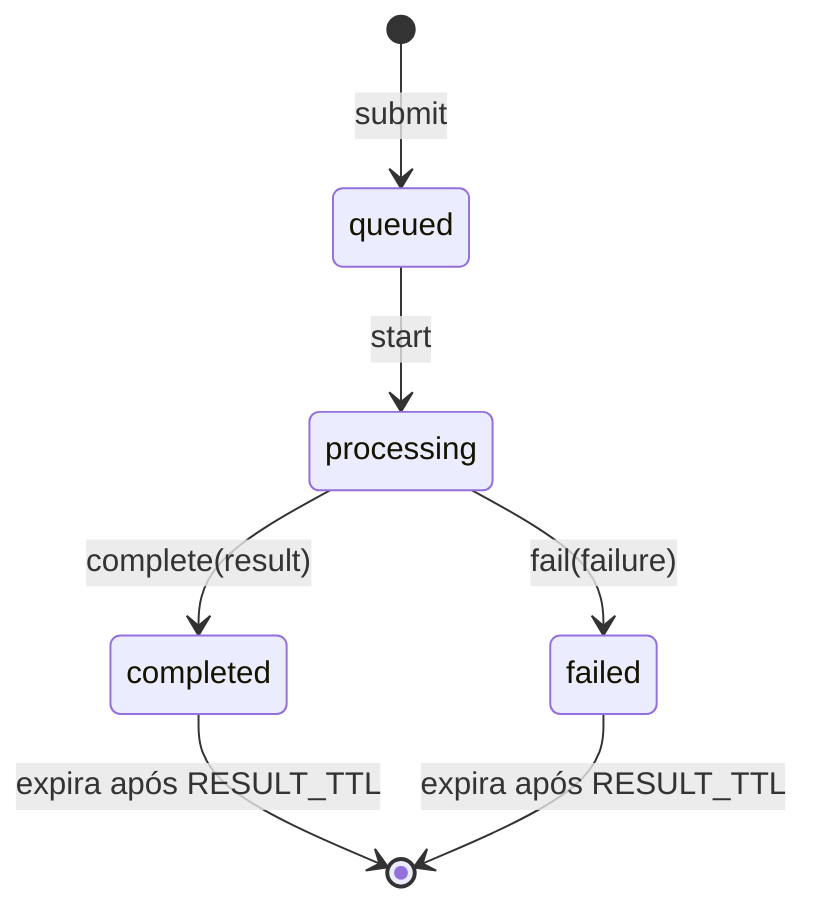

# Domínio do reconhecimento

O vocabulário e as regras do domínio do backend (`backend/src/kanjilens/domain/`), em Python puro ([ADR 0004](../adr/0004-clean-and-hexagonal-architecture.md)). Os tipos são `dataclass` imutáveis que **se validam ao nascer**: um objeto inválido não chega a existir.

## Glossário

| Termo | No código | O que é |
|---|---|---|
| Desenho | `Drawing` (`drawing.py`) | O tamanho do canvas e os traços, como foram desenhados ([ADR 0016](../adr/0016-stroke-order-check-by-bipartite-matching-and-capture-format.md)) |
| Traço | `Stroke` | Os pontos de um traço, na ordem do desenho |
| Ponto | `Point` | `x` e `y` em pixels CSS a partir do canto superior esquerdo; `t` em ms desde o primeiro ponto |
| Tamanho do canvas | `CanvasSize` | Largura e altura em pixels CSS |
| Limites do desenho | `DrawingLimits`, `DRAWING_LIMITS` | Os máximos da ADR 0016; o schema HTTP usa os mesmos valores |
| Modo | `StrokeOrderMode` (`stroke_order.py`) | `ordered` ou `unordered`, escolhido a cada envio |
| Job | `RecognitionJob` (`job.py`) | Um pedido de reconhecimento: id, modo, desenho, estado, resultado ou falha, e os horários |
| Estado do job | `JobStatus` | `queued`, `processing`, `completed` ou `failed` |
| Falha | `JobFailure` | Por que o job falhou. Hoje só `inference_failed` (o processo de inferência deu erro ou caiu) |
| Candidato | `Prediction` (`prediction.py`) | Um kanji e a confiança; no `ordered`, também a avaliação da ordem |
| Resultado | `RecognitionResult` | Os candidatos top-K, do mais para o menos provável |
| Avaliação da ordem | `EvaluatedStrokeOrder`, `NotEvaluatedStrokeOrder` | O desenho comparado com o KanjiVG de um candidato, ou o motivo de não ter sido comparado |
| Problema na ordem | `OrderIssue`, `DirectionIssue`, `JoinedIssue`, `BrokenIssue` | Fora de ordem, direção errada, traços vizinhos unidos, ou um traço desenhado em pedaços |
| Expiração | `RESULT_TTL`, `is_expired` | O job terminado, com o desenho, deixa de existir 5 minutos depois do fim |

## Estados do job

- Cada transição devolve um job novo; o antigo não muda.
- Qualquer outra transição levanta `InvalidJobTransition` (por exemplo, completar um job `queued`).
- Só job terminado expira.
- **O domínio não tem relógio:** quem chama passa o horário (`now`), sempre com fuso. Nos use cases, ele vem de uma função `now` injetada.
- O id é um UUID4 em hexadecimal. Os testes podem passar um id.

## Regras

**Desenho:**

| Regra | Erro | HTTP |
|---|---|---|
| Até 40 traços, 1.000 pontos por traço e 10.000 no total (conferido antes de ler os pontos) | `DrawingTooLarge` (`drawing_too_large`) | `413` |
| Pelo menos um traço, nenhum vazio. Um ponto sozinho (um toque) vale | `InvalidDrawing` (`invalid_drawing`) | `400` |
| Canvas de 64 a 4.096 px por lado | `InvalidDrawing` | `400` |
| Coordenadas finitas, até 10% fora do canvas | `InvalidDrawing` | `400` |
| `t` inteiro, ≥ 0 e nunca decrescente, nem entre traços (pode repetir) | `InvalidDrawing` | `400` |

**Resultado.** Essas regras pegam erro do recognizer, nunca do usuário:
- cada candidato é um caractere, com confiança entre 0 e 1;
- pelo menos um candidato, sem kanji repetido, da maior para a menor confiança;
- a soma das confianças não passa de 1 (com folga de arredondamento);
- no `ordered`, todo candidato traz a avaliação da ordem; no `unordered`, nenhum traz.

**Avaliação da ordem** ([ADR 0016](../adr/0016-stroke-order-check-by-bipartite-matching-and-capture-format.md)):
- posições a partir de 1, dentro da quantidade de traços;
- diferença de no máximo 2 traços; acima disso, `NotEvaluatedStrokeOrder` com `stroke_count_mismatch`. Sem referência, `reference_missing`;
- `JoinedIssue` e `BrokenIssue` só juntam dois ou mais traços vizinhos, em ordem;
- `correct` é calculado: verdadeiro quando não há problema de ordem nem de direção. União e quebra não o tornam falso.

O desenho vai para o processo de inferência, e o resultado volta, por pickle ([ADR 0019](../adr/0019-in-memory-job-queue-with-one-inference-process.md)).

## Erros

Todo erro do domínio herda de `DomainError` e tem um `code` estável, que a API devolve para o frontend traduzir. A mensagem é só para o log, em inglês.

| Código | Quando |
|---|---|
| `invalid_drawing` | O desenho quebra uma regra de formato |
| `drawing_too_large` | O desenho passa de um limite |
| `invalid_prediction` | O recognizer devolveu um resultado inválido (bug) |
| `invalid_stroke_order_evaluation` | O avaliador devolveu uma avaliação inválida (bug) |
| `invalid_job_transition` | Transição de estado proibida (bug) |
| `job_not_found` | Não há job com esse id, ou ele expirou (`404`) |
| `queue_full` | A fila está cheia (`503` com `Retry-After`) |
