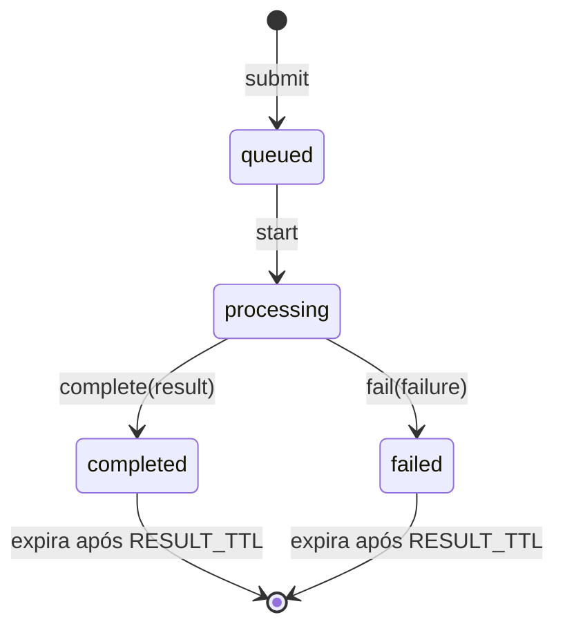

# Domínio do reconhecimento

O vocabulário e as regras do domínio do backend (`backend/src/kanjilens/domain/`), em Python puro, só com a biblioteca padrão ([ADR 0004](../adr/0004-clean-and-hexagonal-architecture.md)). Os tipos são `dataclass` imutáveis que **se validam ao nascer**: um objeto inválido não chega a existir. Este documento muda junto com o código: termo novo, regra nova ou estado novo entram aqui no mesmo PR (`CLAUDE.md`, "Documentos nascem com o assunto").

## Glossário

| Termo | No código | O que é |
|---|---|---|
| Desenho | `Drawing` (`drawing.py`) | O que o canvas manda: o tamanho do canvas e os traços, como foram desenhados ([ADR 0016](../adr/0016-stroke-order-check-by-bipartite-matching-and-capture-format.md)) |
| Traço | `Stroke` | Os pontos de um traço, na ordem do desenho |
| Ponto | `Point` | `x` e `y` em pixels CSS a partir do canto superior esquerdo do canvas; `t` em milissegundos desde o primeiro ponto do desenho |
| Tamanho do canvas | `CanvasSize` | Largura e altura do canvas em pixels CSS |
| Limites do desenho | `DrawingLimits`, `DRAWING_LIMITS` | Os valores máximos de entrada da ADR 0016. O adapter HTTP usa os mesmos valores no schema, para recusar um corpo grande antes de montar os objetos |
| Modo | `StrokeOrderMode` (`stroke_order.py`) | `ordered` (a ordem importa) ou `unordered` (não importa), escolhido por envio. O padrão da interface é `unordered` ([ADR 0012](../adr/0012-ordered-mode-as-stroke-order-evaluation.md)), definido no frontend |
| Job | `RecognitionJob` (`job.py`) | Um pedido de reconhecimento: id, modo, desenho, estado, resultado ou falha, e os horários de criação, início e fim |
| Estado do job | `JobStatus` | `queued`, `processing`, `completed` ou `failed` (diagrama abaixo) |
| Falha | `JobFailure` | O código de por que o job falhou. Hoje só `inference_failed` (o processo de inferência deu erro ou caiu; [ADR 0019](../adr/0019-in-memory-job-queue-with-one-inference-process.md)) |
| Candidato | `Prediction` (`prediction.py`) | Um kanji e a confiança dele (probabilidade da Softmax); no modo `ordered`, também a avaliação da ordem |
| Resultado | `RecognitionResult` | Os candidatos top-K de um job, do mais para o menos provável |
| Avaliação da ordem | `EvaluatedStrokeOrder` ou `NotEvaluatedStrokeOrder` | O desenho comparado com a referência do KanjiVG de um candidato, ou o motivo de não ter sido comparado |
| Problema na ordem | `OrderIssue`, `DirectionIssue`, `JoinedIssue`, `BrokenIssue` | Traço fora de ordem, na direção errada, unindo traços vizinhos da referência, ou um traço da referência desenhado em pedaços |
| Expiração | `RESULT_TTL`, `is_expired` | O job terminado (e o desenho com ele) deixa de existir 5 minutos depois do fim |

## Estados do job

- **Cada transição devolve um job novo.** O job antigo não muda.
- **Qualquer outra transição** levanta `InvalidJobTransition`, por exemplo: completar um job `queued`, reiniciar um job terminado ou falhar um job já `failed`.
- **Só um job terminado expira.** Um job `queued` ou `processing` ainda está sendo esperado.
- **O domínio não tem relógio.** Quem chama passa o horário (`now`), sempre com fuso (*timezone-aware*).
- **O id** é um UUID4 em hexadecimal, gerado na criação. Quem chama pode passar um id, por exemplo nos testes.

## Regras

**Desenho** (`Drawing`):

| Regra | Erro | HTTP (no adapter) |
|---|---|---|
| Até 40 traços, 1.000 pontos por traço e 10.000 pontos no total. É conferido antes de ler os pontos um a um | `DrawingTooLarge` (`drawing_too_large`) | `413` |
| Pelo menos um traço, e nenhum traço vazio. Um ponto sozinho (um "toque") é um traço válido | `InvalidDrawing` (`invalid_drawing`) | `400` |
| Canvas entre 64 e 4.096 px por lado | `InvalidDrawing` | `400` |
| Coordenadas finitas, dentro do canvas com folga de 10% em cada lado | `InvalidDrawing` | `400` |
| `t` inteiro, maior ou igual a 0 e nunca decrescente, nem de um traço para o próximo (pode repetir) | `InvalidDrawing` | `400` |

**Resultado** (`Prediction`, `RecognitionResult`). Essas regras pegam erro do recognizer, nunca da entrada do usuário:
- o candidato é **um caractere** (um code point, inclusive fora do BMP), com confiança finita entre 0 e 1;
- o resultado tem pelo menos um candidato, sem repetir kanji, ordenado da maior para a menor confiança;
- a soma das confianças não passa de 1, com tolerância de arredondamento;
- **o resultado bate com o modo do job:** no `ordered`, todo candidato traz a avaliação da ordem; no `unordered`, nenhum traz. É conferido ao completar o job.

**Avaliação da ordem** ([ADR 0016](../adr/0016-stroke-order-check-by-bipartite-matching-and-capture-format.md)):
- **Numeração:** as posições começam em 1, como na tela, e ficam dentro da quantidade de traços desenhados ou esperados.
- **Quantidade de traços:** a diferença entre desenhados e esperados é de no máximo 2. Acima disso, a avaliação é `NotEvaluatedStrokeOrder` com `stroke_count_mismatch`; sem referência no KanjiVG, `reference_missing`.
- **União e quebra:** `JoinedIssue` (um traço desenhado, `expected_strokes` com as posições da referência que ele une) e `BrokenIssue` (`drawn_strokes` com os pedaços, e o `expected_stroke` que eles formam) só juntam **dois ou mais traços vizinhos, em ordem**.
- **`correct` é calculado**, nunca guardado: é verdadeiro quando não há problema de ordem nem de direção. União e quebra são observações e não o tornam falso.

## Fronteira com o processo de inferência

O desenho vai para o processo de inferência, e o resultado volta dele por pickle ([ADR 0019](../adr/0019-in-memory-job-queue-with-one-inference-process.md)). Todos os tipos do domínio são `dataclass` da biblioteca padrão e passam pelo pickle sem perder nada (há teste disso).

## Erros

Todo erro do domínio herda de `DomainError` e tem um `code` estável, que o adapter HTTP devolve para o frontend traduzir ([ADR 0009](../adr/0009-portuguese-ui-first-then-japanese.md)). A mensagem é só para o log, em inglês.

| Código | Quando |
|---|---|
| `invalid_drawing` | O desenho quebra uma regra de formato |
| `drawing_too_large` | O desenho passa de um limite de tamanho |
| `invalid_prediction` | O recognizer devolveu um resultado inválido (bug) |
| `invalid_stroke_order_evaluation` | O avaliador da ordem devolveu uma avaliação inválida (bug) |
| `invalid_job_transition` | Uma transição de estado proibida (bug) |
